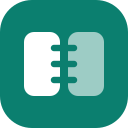
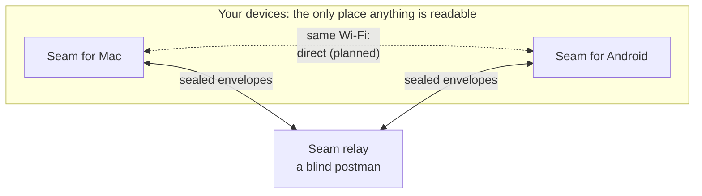
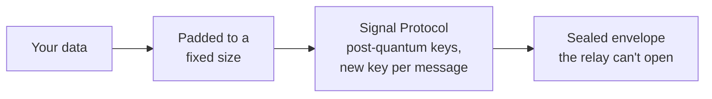

<p align="center">
  
</p>

<h1 align="center">Seam</h1>

<p align="center">
  <strong>Your Android phone and your Mac, stitched together.</strong><br>
  Notifications, texts, clipboard and files between Android and macOS: as seamless as an iPhone, and end-to-end encrypted with the Signal Protocol.
</p>

<p align="center">
  <a href="https://github.com/aveterosystems/seam/actions/workflows/core.yml"></a>
  <a href="https://github.com/aveterosystems/seam/actions/workflows/mac.yml"></a>
  <a href="https://github.com/aveterosystems/seam/actions/workflows/android.yml"></a>
  <a href="https://github.com/aveterosystems/seam/actions/workflows/server.yml"></a>
  <a href="https://github.com/aveterosystems/seam/actions/workflows/protocol.yml"></a>
  <a href="LICENSE"></a>
</p>

---

> **Status: 0.2.1.** Pairing, clipboard both ways, the phone's battery and phone notifications on the Mac work, end to end encrypted through the Seam relay. Everything else below is being built milestone by milestone. It's an early release: expect rough edges.

## Install

Download both apps from the [latest release](https://github.com/aveterosystems/seam/releases/latest), then open Seam on the Mac and scan its code with the phone.

- **Android 12 or later:** open `Seam-<version>-android.apk` on the phone and allow the install.
- **macOS 14 or later** (Apple silicon or Intel): unzip `Seam-<version>-mac.zip` and drag Seam to Applications. Seam isn't notarized by Apple yet, so the first time you open each version macOS blocks it: open **System Settings › Privacy & Security** and click **Open Anyway**.

After that, both apps update themselves: once a day they check GitHub for a newer release (GitHub sees your IP address and Seam's version when they do; turn it off in Settings), (each asks first), and install one only if it's signed with Seam's keys and you say so. Each release says how to check its files yourself.

## What it does

| | Feature | |
|---|---|---|
| 🔔 | **Phone notifications on your Mac**, in Notification Centre, with reply and dismiss that sync both ways. Every app starts off; you choose which ones reach the Mac, and the phone filters before anything leaves it | In 0.2.0 |
| 💬 | **Texts on your Mac**: read and reply from the menu bar or a full Messages window | Planned |
| 📋 | **Clipboard both ways**: Mac to phone automatically; phone to Mac automatically in the GitHub build once you turn on Seam in Android's Accessibility settings (or a one-time setup from the Mac over USB), otherwise one tap | In 0.1.0 |
| 📁 | **Files in either direction**: share sheet, drag onto the menu bar, or the phone in Finder | Planned |
| 🔋 | **Battery and status**: the phone's battery in the Mac's menu bar; a desktop widget later | Battery in 0.1.0 |
| 📣 | **Ring my phone** from the Mac, even on silent | Planned |

It's designed to feel native on both sides: a menu bar app that follows macOS's own look on the Mac, and Material 3 on Android. It uses the system's own surfaces (Notification Centre, the Share menu, Quick Settings) instead of making you open an app.

## How it works



- **Pair once with a QR code.** The phone scans the Mac's screen. That's the whole setup: no accounts, emails or passwords.
- **Through the relay today.** Sealed messages go through the relay, which queues them until the other device connects. The phone connects only when there's something to send or receive, to save battery.
- **Planned:** a direct link when both are on the same Wi‑Fi, and a choice of Automatic, **Local only** (nothing leaves your network), **Internet only** or **your own self-hosted relay**. The encryption is identical in every mode.

## Security

Nobody but your two devices can read anything: not us, not our hosting provider, not Google or Apple, not anyone on your network.



- **The Signal Protocol**, through Signal's own [libsignal](https://github.com/signalapp/libsignal), including its latest **post-quantum** protection (PQXDH and the triple ratchet). Seam has no home-made cryptography.
- **One shared core.** The encryption is written once in Rust and used by both apps, so there's no second copy to get subtly wrong.
- **Keys never leave your devices.** They're created on-device and stored encrypted: on Android under a key in the hardware keystore, on the Mac under a key in your login keychain (moving to the Secure Enclave is planned).
- **Pinned at pairing.** Each device trusts exactly one key, the one it learned from the QR code. A server can't slip itself in between.
- **Every message gets its own key**, and old keys are deleted. A leaked key opens one message, not your history.
- **Fixed-size padding** and **a relay that logs no IP addresses or contents** keep metadata to a minimum (Cloudflare, which hosts the relay, still sees IP addresses at its network edge). Push notifications, when they arrive, will be empty: no content, no sender.
- **Signed releases you can check.** Each release is built by GitHub Actions from a tag on `main`, signed with Seam's own pinned keys, and carries build attestations.
- **Security properties are tested** from Rust, Swift and Kotlin, and the threat model lists what isn't covered yet. An independent audit is planned before 1.0.

Found a vulnerability? Please see [SECURITY.md](SECURITY.md).

## Repository layout

```
seam/
├── core/              The Rust crypto core on libsignal, and its Swift/Kotlin bindings
├── protocol/          The Protobuf message format shared by every codebase
├── apps/
│   ├── mac/           Seam for Mac: SwiftUI menu bar app (macOS 14+)
│   └── android/       Seam for Android: Jetpack Compose (Android 12+)
├── server/            The relay: a Cloudflare Worker that routes sealed envelopes
├── scripts/           Code generation, build and release helpers
├── release/           Release notes template and the pinned signing-certificate fingerprints
└── .github/workflows/ CI: one workflow per part, run only when that part changes
```

## Building from source

| Part | Needs | Build and test |
|---|---|---|
| [Crypto core](core/README.md) | Rust, `protoc` | `cd core && cargo test` |
| [Mac app](apps/mac/README.md) | Xcode 26+, XcodeGen, Rust | `scripts/build-mac-core.sh`, then `cd apps/mac && xcodegen generate && open Seam.xcodeproj` |
| [Android app](apps/android/README.md) | JDK 17, Android SDK + NDK 29, Rust, cargo-ndk | `cd apps/android && ./gradlew test assembleFullDebug` |
| [Relay](server/README.md) | Node 22 | `cd server && npm ci && npm test` |
| [Protocol](protocol/README.md) | `protoc` (buf optional) | `scripts/gen-protocol.sh` |

Each link goes to that part's README, with the details. Releases are built by CI; see [Releasing](CONTRIBUTING.md#releasing).

## Contributing

Contributions are welcome. Please read [CONTRIBUTING.md](CONTRIBUTING.md) first: it covers the setup, the rules every change follows (especially the security ones) and how to add a feature.

## Licence

Copyright © 2026 Avetero.

Seam is free software: you can redistribute it and/or modify it under the terms of the [GNU Affero General Public License v3.0](LICENSE), as published by the Free Software Foundation. It's distributed in the hope that it will be useful, but **without any warranty**; see the licence for details.

In practice: you can use, study, change and share Seam. If you distribute it, or run a modified relay as a network service, you must share your source code under the same licence. Seam builds on open-source work listed in [THIRD_PARTY.md](THIRD_PARTY.md), above all Signal's libsignal.

## Acknowledgements

- [Signal](https://signal.org) for libsignal, the Signal Protocol and its post-quantum work
- [Mozilla](https://github.com/mozilla/uniffi-rs) for UniFFI, which lets one Rust core serve Swift and Kotlin
- [Cryspen](https://cryspen.com) for libcrux's formally verified ML-KEM
