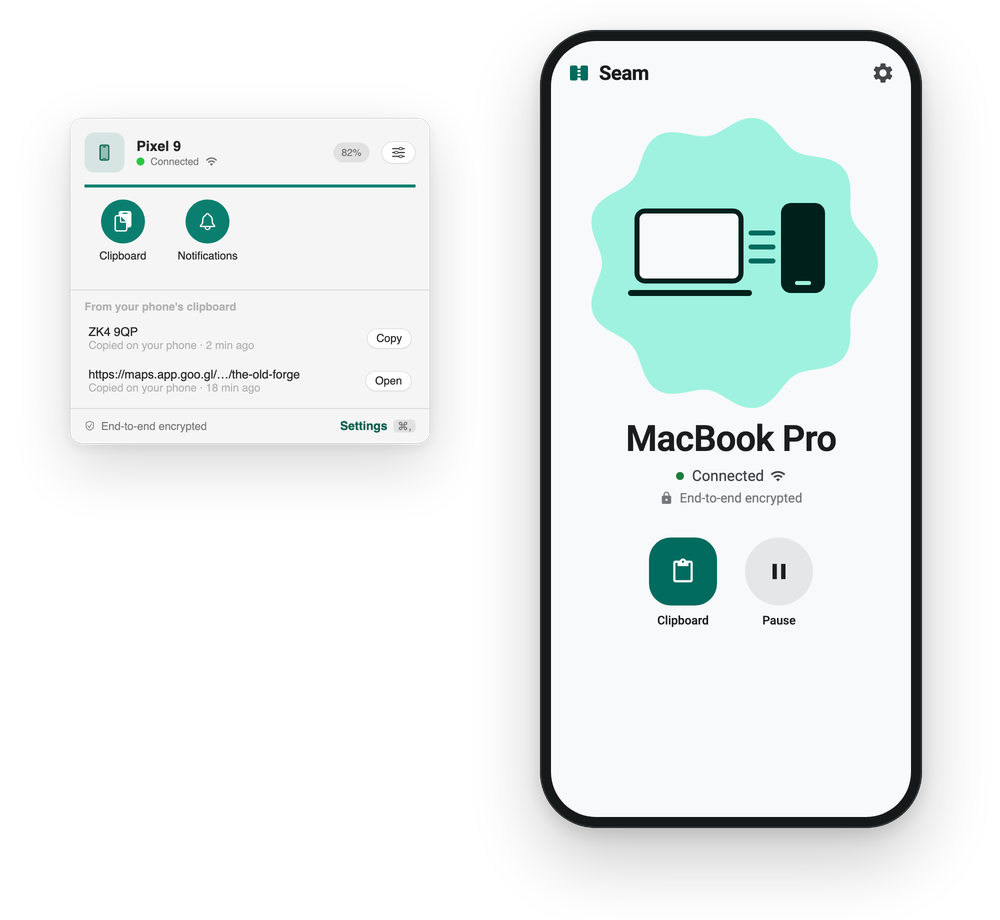
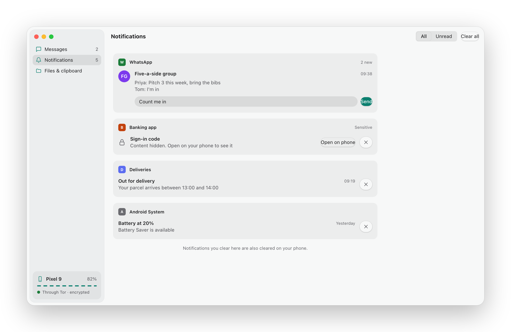
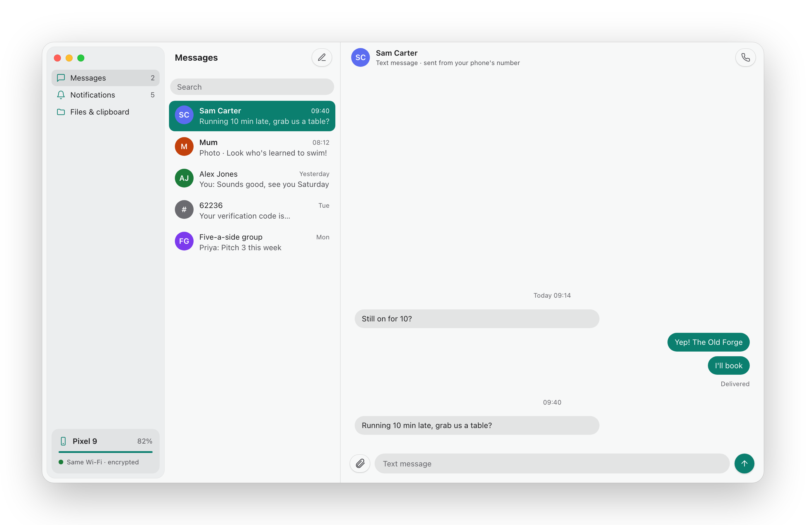
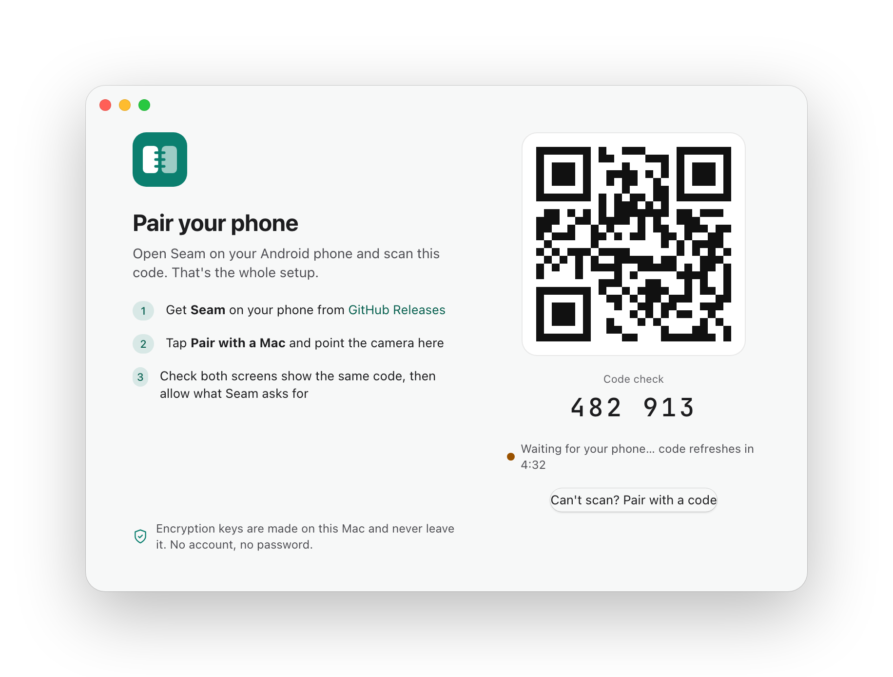

<h1 align="center">Seam</h1>

<p align="center">
  <strong>Your phone and your computer, stitched together.</strong><br>
  Notifications, clipboard and battery from your phone, right there on your desktop.<br>
  End-to-end encrypted with the Signal Protocol. No account. Nothing in the cloud that can read it.
</p>

<p align="center">
  <a href="https://github.com/aveterosystems/seam/releases/latest"><strong>Download the latest release →</strong></a>
</p>

<p align="center">
  <a href="https://github.com/aveterosystems/seam/releases/latest"></a>
  
  
  
  
  <a href="LICENSE"></a>
</p>

<p align="center">
  
</p>

---

## Your phone, on your computer

<p align="center">
  
</p>

### 🔔 Notifications that follow you

Your phone buzzes on the desk. Your computer already knows. Phone notifications land in your desktop's own notifications, and you can reply or dismiss right there. Clear one on the computer and it's gone from the phone too.

You pick which apps get through. Every app starts off, and the phone filters before anything leaves it.

### 📋 Copy here, paste there

Copy on your computer, paste on your phone. Copy a code on your phone, paste it on your computer. No buttons, no sharing sheets, no emailing yourself links.

### 🔋 Battery at a glance

Your phone's charge sits right on your desktop, so you know when it needs a charger before it tells you.

### Coming soon

<p align="center">
  
</p>

- 💬 **Texts on your computer.** Read and reply from your phone's number, in a full Messages window.
- 📁 **Files both ways.** Share sheet, drag and drop, or browse your phone like a drive.
- 📣 **Ring my phone.** Find it down the side of the sofa, even on silent.

## Works where you work

| | Today | Next |
|---|---|---|
| **Phone** | Android 12+ | |
| **Computer** | macOS 14+ | Linux, then Windows |

The encryption, pairing and sync all live in one shared core, so each new platform is a new app on top, not a rewrite.

## Why Seam?

| | **Seam** | Bounce Connect | KDE Connect | Phone Link |
|---|---|---|---|---|
| **Your computer** | Mac today; Linux and Windows next | Mac | Linux, Windows; Mac as nightly builds | Windows |
| **Works away from home** | ✅ Through Tor | Same Wi‑Fi only | Same network only | Through Microsoft's servers |
| **Encryption** | Signal Protocol, end-to-end, post-quantum | AES-256 | TLS | Not published |
| **Hides where you are** | ✅ Tor | Not needed (local only) | Not needed (local only) | No |
| **Account** | None | None | None | Microsoft account |
| **Open source** | ✅ AGPL-3.0 | Not stated | ✅ GPL | No |
| **Price** | Free | Paid Android app | Free | Free with Windows |

<sub>From each project's own pages, October 2026. Something out of date? Please [open an issue](https://github.com/aveterosystems/seam/issues).</sub>

## Set up in ten seconds

<p align="center">
  
</p>

Open Seam on your computer. Scan the code with your phone. That's it.

No account, no email, no password, no sign-in.

## Private by design

Only your two devices can read anything. Not us, not Google or Apple, not anyone on your network.

- **The Signal Protocol**, through Signal's own [libsignal](https://github.com/signalapp/libsignal), with post-quantum protection. No home-made cryptography.
- **Keys never leave your devices.** They're made on each device and pinned when you pair, so nothing can slip in between.
- **A new key for every message.** A leaked key opens one message, not your history.
- **Fast at home, private everywhere.** On the same Wi‑Fi your devices talk directly. Everywhere else they connect through Tor, which also hides where you are. Seam runs no servers that carry your messages.
- **Open source, signed releases.** Every release is built in public by GitHub Actions and signed with Seam's keys.

### Tested, not just promised

Privacy claims are easy to make. Seam's are checked by automated tests in Rust, Swift and Kotlin, and CI runs them on every change:

- 🚫 **No Google tracking, enforced.** The Android build fails if Firebase, Google's telemetry transport or ML Kit ever sneaks in through a dependency.
- 📏 **Size gives nothing away.** Tests prove an encrypted message doesn't reveal how long the original was.
- 🛡️ **Forgeries bounce off.** Tampered, replayed and unknown-sender messages are all rejected.
- 🧅 **Invisible on Tor.** A test on the real Tor network shows only your paired phone can even find your computer, and that Tor keys never touch the disk. This one needs the live network, so it's run by hand, not by CI.
- ⏸️ **Paused means paused.** Pause Seam on your phone and tests check it makes no connections at all.

What the tests don't do, so you know exactly what you're getting:

- The no-tracking check looks for known Google libraries. It doesn't watch every connection the app makes.
- The Mac app has no tracking libraries, but no test enforces that yet.
- Tests prove the code does what it says. They're not a replacement for an outside security review.

Found a vulnerability? Please read [SECURITY.md](SECURITY.md) rather than opening an issue.

## Install

Seam is an early release (0.2.2). Expect rough edges, and tell us about them.

Download both apps from the [latest release](https://github.com/aveterosystems/seam/releases/latest).

| | |
|---|---|
| **Mac** (macOS 14+, Apple silicon or Intel) | Unzip `Seam-<version>-mac.zip` and drag Seam to Applications. Seam isn't notarized by Apple yet, so the first time you open each version, go to **System Settings › Privacy & Security** and click **Open Anyway**. |
| **Android** (12+) | Open `Seam-<version>-android.apk` on the phone and allow the install. |

Both apps keep themselves up to date. They check GitHub once a day, ask before installing, and only accept updates signed with Seam's keys. You can turn this off in Settings.

### Check what you downloaded

Every release is built by GitHub Actions from a tagged commit, and every file carries a GitHub attestation that proves it. With the [GitHub CLI](https://cli.github.com):

```sh
gh attestation verify Seam-<version>-mac.zip --repo aveterosystems/seam \
  --signer-workflow aveterosystems/seam/.github/workflows/release.yml \
  --source-ref refs/tags/v<version>
```

Run the same for `Seam-<version>-android.apk`. Then check the files are signed by Seam. These fingerprints never change; if one ever does, don't install it.

| App | Signing certificate SHA-256 | Check with |
|---|---|---|
| Android | `8da099e274277f70752f943f5081a163d10a434192adee0fc630478844c7459a` | `apksigner verify --print-certs` |
| Mac | `2049f2317d0b7caeac304b764586b661c8e9393a5a6f8328104bd07cdc05c06a` | `codesign -d --extract-certificates`, then `shasum -a 256` |

The same fingerprints are kept in [`release/`](release/).

## Roadmap

- [x] Pair with a QR code, no account
- [x] Clipboard both ways
- [x] Phone battery on the computer
- [x] Phone notifications, with reply and dismiss
- [x] Direct connection on the same Wi‑Fi
- [ ] Works anywhere through Tor, with no Seam servers in between *(in progress)*
- [ ] Files both ways
- [ ] Texts on your computer
- [ ] Ring my phone
- [ ] Seam for Linux
- [ ] Seam for Windows

Follow along in [issues](https://github.com/aveterosystems/seam/issues) and the [changelog](CHANGELOG.md).

## FAQ

<details>
<summary><strong>Is Seam free?</strong></summary>

Yes. Free and open source, with no subscription, no ads and no in-app purchases.
</details>

<details>
<summary><strong>Can you see my messages, clipboard or notifications?</strong></summary>

No. Everything is end-to-end encrypted between your two devices, and Seam runs no servers that carry your data. There are no analytics or tracking either, and [tests keep it that way](#tested-not-just-promised). Besides Tor, the only outside service Seam talks to is GitHub, for the daily update check, which you can turn off.
</details>

<details>
<summary><strong>Do my phone and computer need to be on the same Wi‑Fi?</strong></summary>

No. On the same Wi‑Fi they talk directly. Anywhere else they connect through Tor.
</details>

<details>
<summary><strong>Is Tor slow?</strong></summary>

At home you won't notice it, because the devices talk directly. Away from home, connecting takes a few seconds and each message about half a second more. That's fine for clipboard and notifications, and it hides where you are.
</details>

<details>
<summary><strong>What happens when my laptop is asleep?</strong></summary>

Nothing is lost. Your phone holds on to anything new and sends it once the laptop wakes up, usually within a minute of opening the lid.
</details>

<details>
<summary><strong>What if Tor is blocked where I am?</strong></summary>

Seam keeps working on the same Wi‑Fi. Support for Tor bridges, which get around most blocks, is planned.
</details>

<details>
<summary><strong>Why isn't Seam on Google Play?</strong></summary>

Some features, like automatic clipboard sync, use Android permissions that Google Play restricts. Shipping on GitHub means you get every feature, and updates still arrive automatically.
</details>

<details>
<summary><strong>Does it work with an iPhone?</strong></summary>

Not today. iOS doesn't let apps read other apps' notifications or the clipboard in the background, which Seam needs.
</details>

## Build it yourself

Seam is one Rust core with a native app on each platform: SwiftUI on the Mac and Jetpack Compose on Android so far. Each part has its own README:

[Core](core/README.md) · [Mac app](apps/mac/README.md) · [Android app](apps/android/README.md) · [Protocol](protocol/README.md)

## Contributing

Contributions are welcome. Start with [CONTRIBUTING.md](CONTRIBUTING.md). It covers setup, the security rules every change follows, and how to add a feature.

## Licence

Seam is free software under the [GNU Affero General Public License v3.0](LICENSE). Copyright © 2026 Avetero. It builds on open-source work listed in [THIRD_PARTY.md](THIRD_PARTY.md).

Made possible by [Signal](https://signal.org)'s libsignal, [Mozilla](https://github.com/mozilla/uniffi-rs)'s UniFFI and [Cryspen](https://cryspen.com)'s formally verified ML-KEM.
