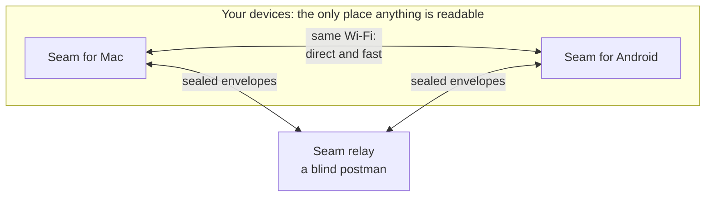
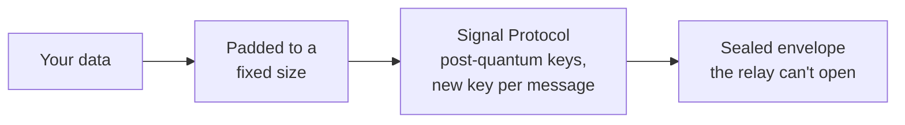

<p align="center">
  
</p>

<h1 align="center">Seam</h1>

<p align="center">
  <strong>Your Android phone and your Mac, stitched together.</strong><br>
  Notifications, texts, clipboard and files between Android and macOS: as seamless as an iPhone, and end-to-end encrypted with the Signal Protocol.
</p>

<p align="center">
  <a href="https://github.com/aveterosystems/seam/actions/workflows/core.yml"></a>
  <a href="https://github.com/aveterosystems/seam/actions/workflows/mac.yml"></a>
  <a href="https://github.com/aveterosystems/seam/actions/workflows/android.yml"></a>
  <a href="https://github.com/aveterosystems/seam/actions/workflows/server.yml"></a>
  <a href="https://github.com/aveterosystems/seam/actions/workflows/protocol.yml"></a>
  <a href="LICENSE"></a>
</p>

---

> **Status: early development.** The foundations are in place and tested: the encryption core, the message format, both app shells and CI. The features below are being built milestone by milestone. Seam isn't ready for everyday use yet.

## What it does

| | Feature | |
|---|---|---|
| 🔔 | **Phone notifications on your Mac**, in Notification Centre, with reply and dismiss that sync both ways | Planned |
| 💬 | **Texts on your Mac**: read and reply from the menu bar or a full Messages window | Planned |
| 📋 | **Clipboard both ways, automatically**: copy on one, paste on the other | Proven on a Galaxy S25 Ultra |
| 📁 | **Files in either direction**: share sheet, drag onto the menu bar, or the phone in Finder | Planned |
| 🔋 | **Battery and status** at a glance, plus a desktop widget | Planned |
| 📣 | **Ring my phone** from the Mac, even on silent | Planned |

It's designed to feel native on both sides: a menu bar app that follows macOS's own look on the Mac, and Material 3 on Android. It uses the system's own surfaces (Notification Centre, the Share menu, Quick Settings) instead of making you open an app.

## How it works



- **Pair once with a QR code.** The phone scans the Mac's screen. That's the whole setup: no accounts, emails or passwords.
- **Same Wi‑Fi?** The devices talk directly. **Apart?** Sealed messages go through the relay, which queues them until the other device wakes.
- **You choose.** Automatic (the default), **Local only** (nothing ever leaves your network), **Internet only**, or **your own self-hosted relay**. The encryption is identical in every mode.

## Security

Nobody but your two devices can read anything: not us, not our hosting provider, not Google or Apple, not anyone on your network.



- **The Signal Protocol**, through Signal's own [libsignal](https://github.com/signalapp/libsignal), including its latest **post-quantum** protection (PQXDH and the triple ratchet). Seam has no home-made cryptography.
- **One shared core.** The encryption is written once in Rust and used by both apps, so there's no second copy to get subtly wrong.
- **Keys never leave your devices.** They're created on-device and stored encrypted under the Secure Enclave or Android's hardware keystore.
- **Pinned at pairing.** Each device trusts exactly one key, the one it learned from the QR code. A server can't slip itself in between.
- **Every message gets its own key**, and old keys are deleted. A leaked key opens one message, not your history.
- **Fixed-size padding**, **empty push notifications** and **a relay that logs no IP addresses or contents** keep metadata to a minimum.
- **Every security claim is tested**, from Rust, Swift and Kotlin. An independent audit is planned before 1.0.

Found a vulnerability? Please see [SECURITY.md](SECURITY.md).

## Repository layout

```
seam/
├── core/              The Rust crypto core on libsignal, and its Swift/Kotlin bindings
├── protocol/          The Protobuf message format shared by every codebase
├── apps/
│   ├── mac/           Seam for Mac: SwiftUI menu bar app (macOS 14+)
│   └── android/       Seam for Android: Jetpack Compose (Android 12+)
├── server/            The relay: a Cloudflare Worker that routes sealed envelopes
├── scripts/           Code generation and build helpers
└── .github/workflows/ CI: one workflow per part, run only when that part changes
```

## Building from source

| Part | Needs | Build and test |
|---|---|---|
| [Crypto core](core/README.md) | Rust, `protoc` | `cd core && cargo test` |
| [Mac app](apps/mac/README.md) | Xcode 26+, XcodeGen, Rust | `scripts/build-mac-core.sh`, then `cd apps/mac && xcodegen generate && open Seam.xcodeproj` |
| [Android app](apps/android/README.md) | JDK 17, Android SDK + NDK 29, Rust, cargo-ndk | `cd apps/android && ./gradlew test assemblePlayDebug` |
| [Relay](server/README.md) | Node 22 | `cd server && npm ci && npm test` |
| [Protocol](protocol/README.md) | `protoc` (buf optional) | `scripts/gen-protocol.sh` |

Each link goes to that part's README, with the details.

## Contributing

Contributions are welcome. Please read [CONTRIBUTING.md](CONTRIBUTING.md) first: it covers the setup, the rules every change follows (especially the security ones) and how to add a feature.

## Licence

Copyright © 2026 Avetero.

Seam is free software: you can redistribute it and/or modify it under the terms of the [GNU Affero General Public License v3.0](LICENSE), as published by the Free Software Foundation. It's distributed in the hope that it will be useful, but **without any warranty**; see the licence for details.

In practice: you can use, study, change and share Seam. If you distribute it, or run a modified relay as a network service, you must share your source code under the same licence. Seam builds on open-source work listed in [THIRD_PARTY.md](THIRD_PARTY.md), above all Signal's libsignal.

## Acknowledgements

- [Signal](https://signal.org) for libsignal, the Signal Protocol and its post-quantum work
- [Mozilla](https://github.com/mozilla/uniffi-rs) for UniFFI, which lets one Rust core serve Swift and Kotlin
- [Cryspen](https://cryspen.com) for libcrux's formally verified ML-KEM
