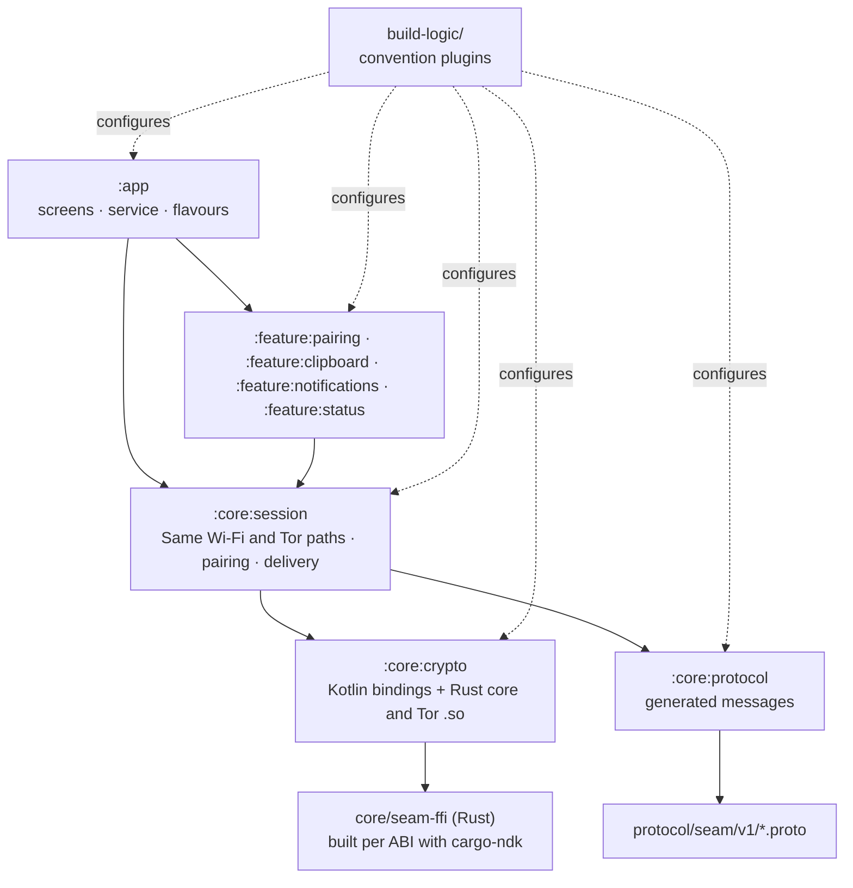

# Seam for Android

A native Android app in Kotlin and Jetpack Compose (Material 3), for Android 12 (API 31) and later. It mirrors notifications to your Mac, syncs the clipboard, and sends the phone's battery and status; texts and files are planned.

> **Status:** 0.2.4. Pairs with a Mac by scanning its QR code, connects on the same Wi‑Fi or through Tor (Arti, inside the app), syncs the clipboard both ways, sends the battery level, Wi‑Fi or mobile data and Do Not Disturb (and shows the Mac's battery), mirrors the notifications of the apps you choose (with reply and dismiss from the Mac), can be paused from the phone or its Quick Settings tile, and connects only when there's something to move. Tested on a Galaxy S25 Ultra running Android 17. Get it from [Releases](https://github.com/aveterosystems/seam/releases/latest).

## Screens

Built to the design boards: Home (A01), pairing with Seam's own camera view (A02), the set-up checklist after pairing (A03), the Send to Mac share sheet (A04), and Settings with Notifications and About (A06). Teal accents, the same as the Mac, on neutral surfaces, in light and dark. Screens are built from the shared pieces in `Components.kt`.

## Modules



| Module | What |
|---|---|
| `app` | The application: the screens, `ConnectionService`, the share sheet, the Quick Settings tile, pause, updates (`Updates.kt`), the after-restart reminder, and the `play` / `full` flavours |
| `core/session` | The phone's link to its Mac: `Session` (delivery and acks, the features), with `Outbox` (what waits), `Wakefulness` (when to connect), `Pairing` and `Switches` (switches and Hello), over two paths, both run by `LanPath` (finding the Mac, the handshake, backoff): Same Wi‑Fi through `Lan`, and Tor through `TorLan` (the core's Tor, dormant whenever nothing needs it). Which path to use comes from the core |
| `feature/pairing` | The camera view: CameraX frames decoded on the phone by ZXing (no network code, no Google services) |
| `feature/clipboard` | Clipboard both ways, the share and copy rules, and automatic phone → Mac in the `full` build |
| `feature/notifications` | The notification listener, the per-app settings (every app starts off; the phone filters before anything is sent), and reply, buttons and dismiss from the Mac |
| `feature/status` | The battery level, Wi‑Fi or mobile data and Do Not Disturb for the Mac, and the Mac's battery |
| `core/crypto` | The Kotlin bindings to the Rust core (`seam_ffi.kt`, generated) and the native library for each ABI |
| `core/protocol` | Message types generated from `protocol/` at build time (protobuf-kotlin lite) |
| `build-logic/convention` | Shared Gradle setup: `seam.android.application`, `seam.android.library`, `seam.android.compose` |
| `gradle/libs.versions.toml` | Every dependency version, in one place |

More `feature/*` modules are added as their milestones start.

## Flavours

| Flavour | Distribution | Differences |
|---|---|---|
| `play` | Google Play | No SMS permission; texts are answered through notification replies |
| `full` | GitHub Releases (sideloaded) | Supports automatic phone → Mac clipboard (and SMS, when texts arrive). This is the build in each release. |

## Building

**Needs:** JDK 17, the Android SDK, NDK `29.0.14206865`, Rust (rustup) with the Android targets, [cargo-ndk](https://github.com/bbqsrc/cargo-ndk) and `protoc`.

```bash
# One-time Rust setup
rustup target add aarch64-linux-android armv7-linux-androideabi x86_64-linux-android
cargo install cargo-ndk --version 4.1.2 --locked

# Build both flavours
cd apps/android
./gradlew assemblePlayDebug assembleFullDebug
```

Gradle builds the Rust core for `arm64-v8a`, `armeabi-v7a` and `x86_64` automatically and packs it into the APK. Install on a phone with USB debugging on:

```bash
adb install -r app/build/outputs/apk/full/debug/app-full-debug.apk
```

Release builds are built and signed by the release workflow, never locally; see [Releasing](../../CONTRIBUTING.md#releasing).

## Testing

```bash
cd apps/android
./gradlew test
```

| Suite | What it proves |
|---|---|
| `SeamCoreTest` | Kotlin pairs through the Rust core and talks after a restart; a wrong pairing code, an unknown sender and bad state are refused; file chunks open only in order and a cut-short file fails |
| `ProtocolTest` | The golden vector decodes and re-encodes byte for byte; fields from newer apps don't break parsing |
| `SessionTest` | Pairing through Tor or on Same Wi‑Fi (both tried, only one pairs; someone else's Mac can't take it), Codes don't match (including just after the Mac accepted), delivery and acks, Same Wi‑Fi first and Tor when it drops, the switches and Hellos, unpairing, pause, when the phone connects and goes idle, a relay-era pairing asked to pair again, and a dead link given up in seconds (the Mac's Hello doesn't list it, or 8 s with no ack while Tor is up) |
| `OutboxTest` | Only the latest clipboard or status waits, the queue is capped, expired messages drop, and a status alone never wakes the radio |
| `LanPathTest` | A handshake that takes too long is given up and tried again later; the phone never looks for the Mac when no connection is wanted |
| `TorLanTest` | Tor starts once, is dormant whenever no stream is open and nothing is looking, dials only the current onion address, and shows why it's blocked |
| `SmallTests` | The saved list of what the Mac hasn't acked, a frame sent just before close, local-only addresses, the pairing code (a relay-era code is refused), and backoff |
| `ClipRulesTest`, `CopyMatchTest`, `LogMatchTest` | No echoes or repeats, size limits, the share preview shows hidden characters, a Mac copy stops showing after 10 minutes; what counts as a copy for the automatic clipboard |
| `NotificationRulesTest`, `NotificationPrefsTest` | What's mirrored and once; lock-screen secrets are title only; the Mac can act only on what it was sent; apps start off; settings survive saving |
| `PauseTest`, `LookTest`, `LinkLookTest`, `AgoTest` | Pause choices end when they say; the status lines and words |
| `ScreensTest` | Renders every screen state, light and dark, to compare with the design prototype (only with `-Pscreens`) |
| `UpdateFeedTest` | Only a newer, complete, published release from this repo is offered, with its checksum |
| `QrDecoderTest` | A QR code is read from a padded camera frame; an empty frame reads nothing |
| `MacStatusTest` | The Mac's battery is kept with when it came, and never shows over 100 |
| `NoGoogleTelemetryTest` | No ML Kit, Google telemetry transport or Firebase on the app's classpath |

The crypto tests run on the JVM against a host build of the same Rust library, so they exercise the real code, not a mock.

## Generated code

`core/crypto/src/main/kotlin/com/avetero/seam/crypto/seam_ffi.kt` is generated by `scripts/gen-bindings.sh`. Don't edit it by hand; CI fails if it drifts from the Rust code.
