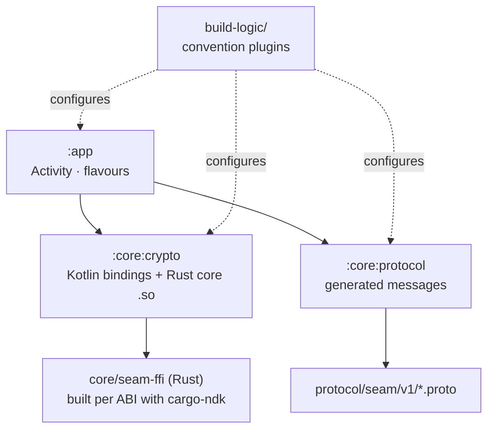

# Seam for Android

A native Android app in Kotlin and Jetpack Compose (Material 3), for Android 12 (API 31) and later. It mirrors notifications and texts to your Mac, syncs the clipboard, and sends and receives files.

> **Status:** M0 shell. The app launches and proves the Rust crypto core loads on a real device. It's been tested on a Galaxy S25 Ultra running Android 17. The real features arrive from M1.

## Modules



| Module | What |
|---|---|
| `app` | The application: `MainActivity`, and the `play` / `full` flavours |
| `core/crypto` | The Kotlin bindings to the Rust core (`seam_ffi.kt`, generated) and the native library for each ABI |
| `core/protocol` | Message types generated from `protocol/` at build time (protobuf-kotlin lite) |
| `build-logic/convention` | Shared Gradle setup: `seam.android.application`, `seam.android.library`, `seam.android.compose` |
| `gradle/libs.versions.toml` | Every dependency version, in one place |

More modules (`core/session`, `core/transport`, `feature/*`…) are added as their milestones start.

## Flavours

| Flavour | Distribution | Differences |
|---|---|---|
| `play` | Google Play | No SMS permission; texts are answered through notification replies |
| `full` | GitHub Releases (sideloaded) | Reads and sends SMS, and supports automatic phone → Mac clipboard |

## Building

**Needs:** JDK 17, the Android SDK, NDK `29.0.14206865`, Rust (rustup) with the Android targets, [cargo-ndk](https://github.com/bbqsrc/cargo-ndk) and `protoc`.

```bash
# One-time Rust setup
rustup target add aarch64-linux-android armv7-linux-androideabi x86_64-linux-android
cargo install cargo-ndk

# Build both flavours
cd apps/android
./gradlew assemblePlayDebug assembleFullDebug
```

Gradle builds the Rust core for `arm64-v8a`, `armeabi-v7a` and `x86_64` automatically and packs it into the APK. Install on a phone with USB debugging on:

```bash
adb install -r app/build/outputs/apk/play/debug/app-play-debug.apk
```

## Testing

```bash
cd apps/android
./gradlew test
```

| Suite | What it proves |
|---|---|
| `SeamCoreTest` | Kotlin can pin, start a session, encrypt and decrypt through the Rust core; impostors fail with `UntrustedIdentity`; unpaired peers fail with `NotPaired`; file chunks reject reordering |
| `ProtocolTest` | The golden vector decodes and re-encodes byte for byte; fields from newer apps don't break parsing |

The crypto tests run on the JVM against a host build of the same Rust library, so they exercise the real code, not a mock.

## Generated code

`core/crypto/src/main/kotlin/com/avetero/seam/crypto/seam_ffi.kt` is generated by `scripts/gen-bindings.sh`. Don't edit it by hand; CI fails if it drifts from the Rust code.
