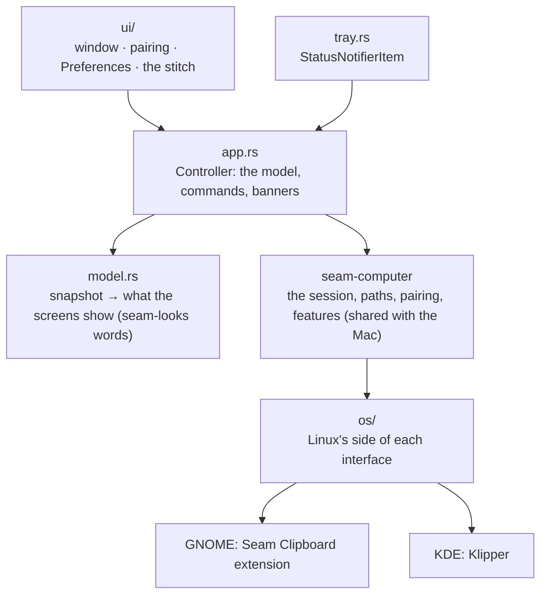

# Seam for Linux

A native GTK 4 and libadwaita app in Rust, for GNOME and KDE Plasma on Wayland. It shows your phone's notifications (reply, buttons, dismiss on both), syncs the clipboard both ways and shows the phone's battery, like the Mac app. It follows the GNOME Human Interface Guidelines and keeps running in the background when its window closes.

> **Status:** in development, not released yet. Builds from source; the Flatpak for Flathub is set up but not published. Pairs with a phone by QR code, connects on the same Wi‑Fi or through Tor. Tested on Fedora 45 with GNOME 51 and Plasma 6.8.

## How it's put together



| Path | What |
|---|---|
| `src/app.rs` | The `Controller`: starts the core's `Computer` (decision 0014), turns its snapshots into the `Model`, shows the phone's notifications as banners, and passes what the user does back |
| `src/model.rs` | What the screens show, from the snapshot, with the shared looks' words (`core/seam-looks`, decision 0015) and Adwaita icon names; unit-tested |
| `src/os/` | Linux's side of each core interface: `keys` (the keyring, through `oo7`), `battery` (the kernel's power supply, UPower for changes, `/proc` for CPU and memory), `same_wifi` (mDNS, and which addresses are Wi‑Fi or wired), `banners` (GNotification), `clipboard` and `doors` (automatic clipboard: the GNOME extension, Klipper, or one tap), `adb` (the phone's one-time setup), `background` (open at login), `system` (the computer's name, waking from sleep) |
| `src/ui/` | The main window (`window`), its pages (`notifications`, `clipboard`, `pairing`), Preferences (`preferences`), the clipboard setup dialogs (`setup`), and Seam's own pieces (`stitch`, `phone`, `widgets`) |
| `src/tray.rs` | The tray icon and menu, where the desktop has a tray |
| `src/demo.rs` | Debug only: made-up state for every screen (`SEAM_DEMO`) |
| `gnome-extension/` | The GNOME Shell extension that gives Seam the clipboard on GNOME. It only answers the Seam app |
| `data/` | The desktop entry, AppStream metadata and icons (with a few Adwaita icons as a fallback where a theme lacks them) |
| `flatpak/` | The Flatpak manifest and the vendored crate list (`scripts/gen-flatpak-sources.sh`) |

## Building

**Needs:** Rust (rustup reads `rust-toolchain.toml`), `protoc`, and GTK 4.16+ and libadwaita 1.7+ with their development files. On Fedora:

```bash
sudo dnf install gcc clang protobuf-compiler gtk4-devel libadwaita-devel dbus-devel
cd apps/linux
cargo run
```

Debug builds keep their own data (`~/.local/share/seam-debug`) and keyring entry, so they run next to an installed Seam.

**Flatpak:** `flatpak-builder --user --install build-dir apps/linux/flatpak/com.avetero.Seam.yml` (needs the GNOME 49 SDK and the Rust SDK extension).

**Automatic clipboard while developing:** on GNOME, copy `gnome-extension/seam-clipboard@avetero.com` to `~/.local/share/gnome-shell/extensions/`, log out and in, enable it, and create `~/.config/seam/allow-development-build` so it lets a build outside Flatpak in. On KDE nothing is needed: Seam uses Klipper.

## Looking at every screen

Debug builds take a few switches, for screenshots and design review:

| Variable | Does |
|---|---|
| `SEAM_DEMO=<state>` | Made-up data instead of starting Seam: `connected`, `tor`, `offline`, `paused`, `connecting`, `empty`, `off`, `unpaired`, `confirm`, `error` |
| `SEAM_OPEN=<what>` | Opens `clipboard`, `prefs:<page>` (`general`, `phone`, `notifications`, `clipboard`, `privacy`), `setup`, `phone-setup` or `about` at launch |
| `SEAM_SIZE=<w>x<h>` | The window's size, for narrow layouts |
| `SEAM_PAIRING_CODE_FILE=<path>` | Writes the pairing code there, for test phones without a camera |
| `SEAM_DATA_FOLDER=<name>` | Another data folder, to run a second computer |

## Testing

`cargo test` covers the model, the clipboard's doors and rules, battery and system parsing, banners and the adb setup. `gjs -m gnome-extension/trust.test.js` covers the extension's access check. CI runs both, `cargo clippy -D warnings` and `cargo fmt --check` (`.github/workflows/linux.yml`), and builds the Flatpak.
