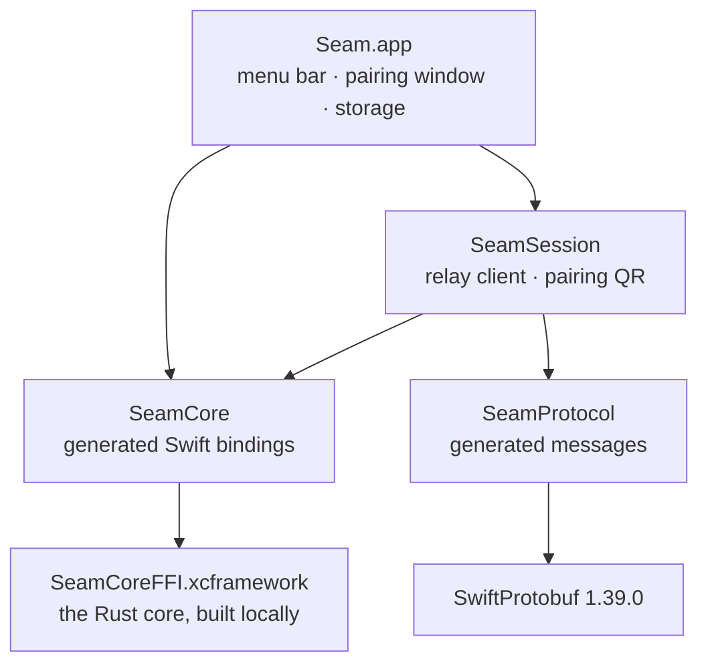

# Seam for Mac

A native macOS menu bar app in Swift 6 and SwiftUI, for macOS 14 and later. It shows your phone's notifications and texts, syncs the clipboard, and sends and receives files. It follows macOS's own design and lives in the menu bar, with no Dock icon.

> **Status:** 0.2.1. Pairs with a phone by QR code through relay.avetero.com, syncs the clipboard both ways, shows the phone's battery in the menu bar, shows the phone's notifications as banners with reply and dismiss (settings in Settings › Notifications, on/off and pause in the popover), and keeps its keys sealed on disk under a Keychain key. The menu bar popover (board M01), pairing window (M02) and Settings with About (M03) follow the designs. Get it from [Releases](https://github.com/aveterosystems/seam/releases/latest).

## How it's put together



| Folder | What |
|---|---|
| `project.yml` | XcodeGen spec for the app target. The `.xcodeproj` is generated from it and never committed. |
| `Seam/App/` | Entry point and menu (`SeamApp.swift`), and `SeamController`: the device, the relay connection, pairing and the phone's status |
| `Seam/Storage/` | `Keychain` (the 32-byte storage key) and `Store` (the sealed state file, group id, relay URL) |
| `Seam/Pairing/` | The pairing window (board M02) and QR rendering |
| `Seam/Notifications/` | `PhoneNotifications`: the phone's notifications as banners, and what you do to them sent back |
| `Seam/UI/` | The popover, Settings, and `Components.swift`: the shared pieces (module button, settings group and row) every screen is built from |
| `Packages/SeamSession/` | `RelayClient` (login by signed challenge, acks, reconnect with backoff), `LanServer` (the same‑Wi‑Fi link: Bonjour `_seam._tcp`, crypto in the core's `LanChannel`), `Paths`/`Outbox` (which path a message may take; decision 0006), `RelayLink` (your own relay; decision 0007), frame builders, the pairing QR format, and their tests |
| `Packages/SeamCore/` | Swift bindings to the Rust core (`Sources/SeamCore/SeamCore.swift`, generated), the C header and module map (`FFI/include/`), and the tests |
| `Packages/SeamProtocol/` | The generated message types (`Sources/SeamProtocol/Generated/`) and the golden-vector tests |

## Building

**Needs:** Xcode 26 or later, [XcodeGen](https://github.com/yonaskolb/XcodeGen) 2.46 (`brew install xcodegen`), Rust (rustup) and `protoc` (`brew install protobuf`).

```bash
# 1. Build the Rust core as an XCFramework (rerun after changing core/)
scripts/build-mac-core.sh

# 2. Generate the Xcode project and open it
cd apps/mac
xcodegen generate
open Seam.xcodeproj
```

Run the **Seam** scheme. A Seam icon appears in the menu bar; its menu shows "Crypto core loaded".

For a universal (Apple silicon and Intel) build of the core: `ARCHS="arm64 x86_64" scripts/build-mac-core.sh`.

## Running against a local relay

```bash
cd server && npm ci && npx wrangler dev --ip 0.0.0.0     # the relay on port 8787
```

The QR code carries the Mac's relay URL, so the phone must be able to reach it. For a real phone on the same Wi‑Fi, point a Debug build at the Mac's LAN address before launching Seam:

```bash
defaults write com.avetero.seam.debug relayURL ws://<this Mac's LAN IP>:8787
```

Debug builds are **Seam Debug** (`com.avetero.seam.debug`), with their own data folder (`Application Support/Seam Debug`), Keychain item and pairing, so they run next to an installed Seam without touching it. To try one against the real relay, use `wss://relay.avetero.com` above. macOS only lets an app post notifications from a normal location, so copy Seam Debug to `/Applications` to test them.

Debug builds default to `ws://localhost:8787` and are the only ones allowed plain `ws://` (their Info.plist, `Config/Debug-Info.plist`, adds the local-networking ATS exception). Release builds have no ATS exception, accept only `wss://` relays, ignore the `defaults` override, and use `RelayPolicy.productionURL` (`wss://relay.avetero.com`). The relay URL is saved with the group on first launch.

## Where things are kept

| What | Where |
|---|---|
| Identity, peers, Signal sessions, prekeys | `~/Library/Application Support/Seam/state.bin`, sealed with AES-256-GCM by the Rust core, file mode 0600 |
| The key that seals it | The login Keychain, service `com.avetero.seam` (local to this Mac) |
| Group id, relay URL | Inside `state.bin` (the core's sealed app data), so they can't drift from the identity they belong to. Older installs move them out of `defaults` once |

Seam never overwrites saved data it can't open. If `state.bin` is damaged or its Keychain key is gone, the menu offers **Reset Seam…**, which moves the old files aside (`state.bin.unreadable-<time>`) and starts over with new keys and a new group. To start over by hand: quit Seam, delete `state.bin`, and remove the `com.avetero.seam` item in Keychain Access. Unsigned dev builds may ask for Keychain access after each rebuild, because the code signature changes. Releases are signed with Seam's own certificate, so a new release should keep access without asking (to be confirmed across two real releases).

## Testing

```bash
scripts/build-mac-core.sh
swift test --package-path apps/mac/Packages/SeamCore       # the Rust core through the Swift bindings
swift test --package-path apps/mac/Packages/SeamProtocol   # the golden vector, shared with Android and the relay
swift test --package-path apps/mac/Packages/SeamSession    # relay login, acks, backoff, the pairing QR
```

| Suite | What it proves |
|---|---|
| `SeamCoreTests` | Swift pairs through the Rust core (request, confirmation, PairAccept) and talks after a restart; an unconfirmed phone isn't saved; app data is sealed with the state; file chunks open only in order and a cut-short file fails |
| `GoldenVectorTests` | Swift decodes the shared golden vector byte for byte, and `Hello` carries the connection policy |
| `PairingQRTests` | The QR format round-trips, uses only unreserved characters, and rejects wrong schemes, versions and lengths |
| `FramesTests` | The login signature verifies over the relay's exact bytes; frames round-trip; backoff doubles from 1 s, caps at 60 s, and resets only after 30 s connected |
| `RelayClientTests` | Login answers a 32-byte challenge and asks to create the group; nothing but a login result is accepted before login, and no second challenge after; a silent relay times out; a refused login reaches the app; envelopes are acked only after they're handled |
| `AppDataTests` | The group id and relay URL encoding round-trips, refuses anything malformed, and survives the core's sealed state |
| `RelayPolicyTests` | Release builds accept only `wss://`; odd relay values fall back instead of crashing |
| `PairingFlowTests` | Codes expire after 5 minutes and a reconnect re-announces only what's left; Pair works once and can't race Cancel; late events can't skip a step |

## Generated code

Don't edit these by hand. CI fails if they drift from their sources.

| File | Regenerate with |
|---|---|
| `Packages/SeamCore/Sources/SeamCore/SeamCore.swift`, `Packages/SeamCore/FFI/include/*` | `scripts/gen-bindings.sh` |
| `Packages/SeamProtocol/Sources/SeamProtocol/Generated/**` | `scripts/gen-protocol.sh` (needs `protoc-gen-swift` 1.39.0) |

## Planned

The rest of the menu bar popover, the Messages, Notifications history and Files windows, the Share extension and a Finder File Provider, each as a feature module behind the shared `Feature` interface. Moving the storage key to the data-protection keychain, wrapped by a Secure Enclave key, which needs an Apple Developer signature. Releases are signed with Seam's own certificate but not notarized, so the first download needs Open Anyway once; notarization comes with an Apple Developer account.

## Updates

Release builds update through [Sparkle](https://sparkle-project.org) 2.10.0, pinned by commit in `Package.resolved`. Sparkle asks once whether to check; then once a day (Settings › About can turn it off) Seam reads `appcast.xml` from the latest GitHub release. Sparkle requires the feed itself to be signed (`SURequireSignedFeed`, with no fallback) and the update to be signed with Seam's update key (`SUPublicEDKey` in `Config/Release-Info.plist`). That key is the root of trust for Mac updates: Sparkle doesn't also compare the new app's certificate. It asks before installing; nothing installs automatically. Debug builds don't update.

Releases are signed with `Config/Release.entitlements`, which turns off library validation: a certificate without an Apple Team ID can't otherwise load Sparkle.framework.
