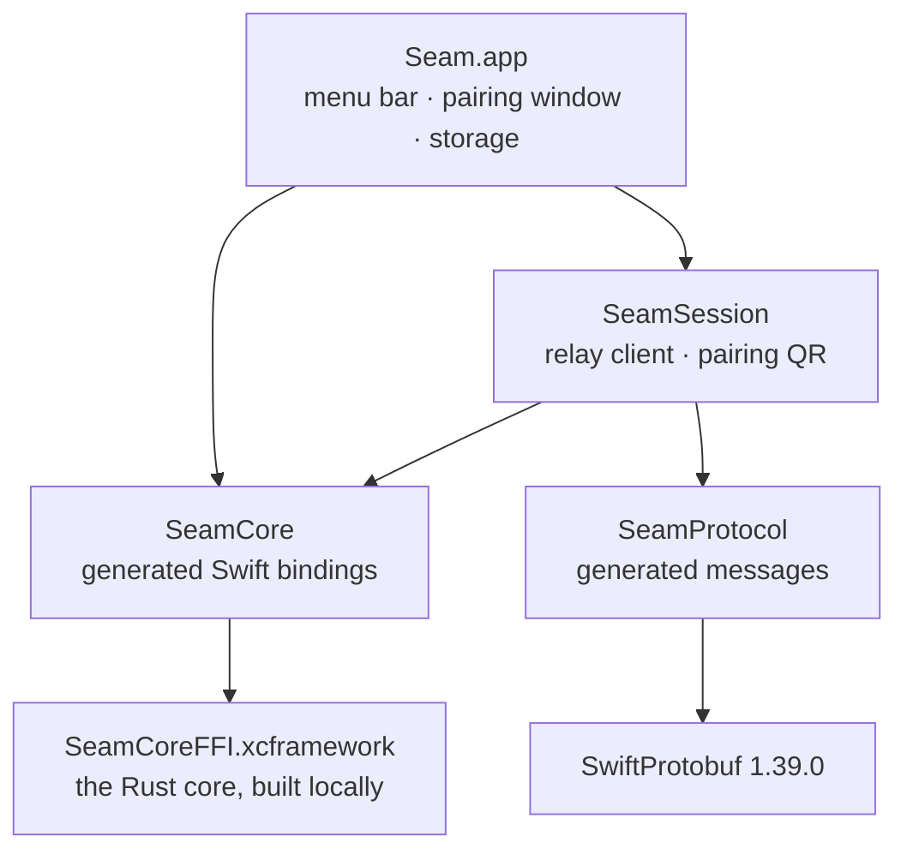

# Seam for Mac

A native macOS menu bar app in Swift 6 and SwiftUI, for macOS 14 and later. It shows your phone's notifications and texts, syncs the clipboard, and sends and receives files. It follows macOS's own design and lives in the menu bar, with no Dock icon.

> **Status:** M1. Pairs with a phone by QR code through the relay, keeps its keys sealed on disk under a Keychain key, and shows the phone's battery in the menu bar.

## How it's put together



| Folder | What |
|---|---|
| `project.yml` | XcodeGen spec for the app target. The `.xcodeproj` is generated from it and never committed. |
| `Seam/App/` | Entry point and menu (`SeamApp.swift`), and `SeamController`: the device, the relay connection, pairing and the phone's status |
| `Seam/Storage/` | `Keychain` (the 32-byte storage key) and `Store` (the sealed state file, group id, relay URL) |
| `Seam/Pairing/` | The pairing window (board M02) and QR rendering |
| `Packages/SeamSession/` | `RelayClient` (login by signed challenge, acks, reconnect with backoff), frame builders, the pairing QR format, and their tests |
| `Packages/SeamCore/` | Swift bindings to the Rust core (`Sources/SeamCore/SeamCore.swift`, generated), the C header and module map (`FFI/include/`), and the tests |
| `Packages/SeamProtocol/` | The generated message types (`Sources/SeamProtocol/Generated/`) and the golden-vector tests |

## Building

**Needs:** Xcode 26 or later, [XcodeGen](https://github.com/yonaskolb/XcodeGen) (`brew install xcodegen`), Rust (rustup) and `protoc` (`brew install protobuf`).

```bash
# 1. Build the Rust core as an XCFramework (rerun after changing core/)
scripts/build-mac-core.sh

# 2. Generate the Xcode project and open it
cd apps/mac
xcodegen generate
open Seam.xcodeproj
```

Run the **Seam** scheme. A Seam icon appears in the menu bar; its menu shows "Crypto core loaded".

For a universal (Apple silicon and Intel) build of the core: `ARCHS="arm64 x86_64" scripts/build-mac-core.sh`.

## Running against a local relay

```bash
cd server && npm ci && npx wrangler dev --ip 0.0.0.0     # the relay on port 8787
```

The QR code carries the Mac's relay URL, so the phone must be able to reach it. For a real phone on the same Wi‑Fi, point the Mac at its LAN address before launching Seam:

```bash
defaults write com.avetero.seam relayURL ws://<this Mac's LAN IP>:8787
```

The default is `ws://localhost:8787`. Production will use `wss://`.

## Where things are kept

| What | Where |
|---|---|
| Identity, peers, Signal sessions, prekeys | `~/Library/Application Support/Seam/state.bin`, sealed with AES-256-GCM by the Rust core, file mode 0600 |
| The key that seals it | The login Keychain, service `com.avetero.seam` (this device only) |
| Group id, relay URL | `defaults read com.avetero.seam` (not secret) |

To start over: quit Seam, delete `state.bin`, and remove the `com.avetero.seam` item in Keychain Access. Unsigned dev builds may ask for Keychain access after each rebuild, because the code signature changes.

## Testing

```bash
scripts/build-mac-core.sh
swift test --package-path apps/mac/Packages/SeamCore       # the Rust core through the Swift bindings
swift test --package-path apps/mac/Packages/SeamProtocol   # the golden vector, shared with Android and the relay
swift test --package-path apps/mac/Packages/SeamSession    # relay login, acks, backoff, the pairing QR
```

| Suite | What it proves |
|---|---|
| `SeamCoreTests` | Swift can pin, start a session, encrypt and decrypt through the Rust core; impostors are refused with `UntrustedIdentity`; file chunks reject reordering |
| `GoldenVectorTests` | Swift decodes the shared golden vector byte for byte, and `Hello` carries the connection policy |
| `PairingQRTests` | The QR format round-trips, uses only unreserved characters, and rejects wrong schemes, versions and lengths |
| `FramesTests` | The login signature verifies over the relay's exact bytes; frames round-trip; backoff doubles from 1 s and caps at 60 s |
| `RelayClientTests` | Login answers the challenge; envelopes are acked only after they're handled; a refused login ends the connection |

## Generated code

Don't edit these by hand. CI fails if they drift from their sources.

| File | Regenerate with |
|---|---|
| `Packages/SeamCore/Sources/SeamCore/SeamCore.swift`, `Packages/SeamCore/FFI/include/*` | `scripts/gen-bindings.sh` |
| `Packages/SeamProtocol/Sources/SeamProtocol/Generated/**` | `scripts/gen-protocol.sh` (needs `protoc-gen-swift` 1.39.0) |

## Planned

The full menu bar popover, the Messages, Notifications and Files windows, Settings, the Share extension and a Finder File Provider, each as a feature module behind the shared `Feature` interface. Signed builds move the storage key to the data-protection keychain, wrapped by a Secure Enclave key. Distributed as a notarised DMG with Sparkle updates.
