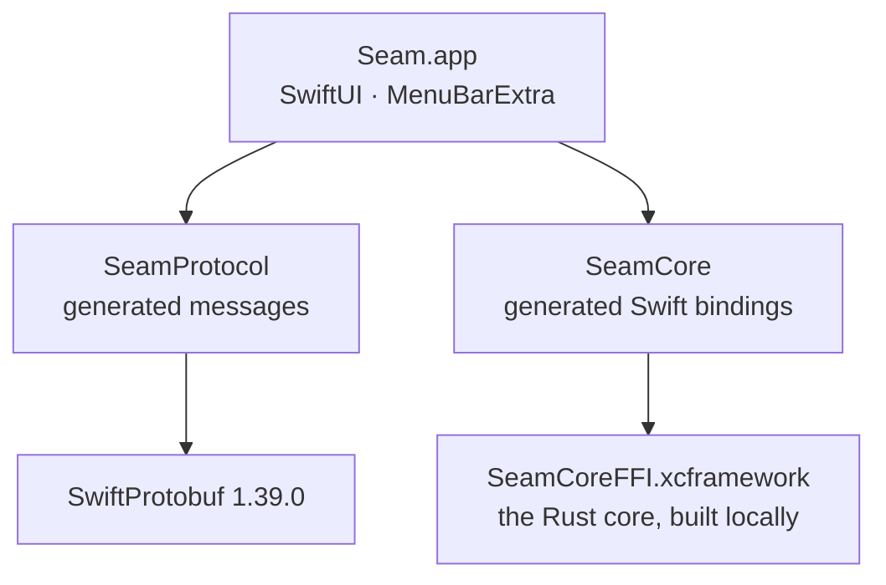

# Seam for Mac

A native macOS menu bar app in Swift 6 and SwiftUI, for macOS 14 and later. It shows your phone's notifications and texts, syncs the clipboard, and sends and receives files. It follows macOS's own design and lives in the menu bar, with no Dock icon.

> **Status:** M0 shell. The app launches as a menu bar item and proves the Rust crypto core loads. The real features arrive from M1.

## How it's put together



| Folder | What |
|---|---|
| `project.yml` | XcodeGen spec for the app target. The `.xcodeproj` is generated from it and never committed. |
| `Seam/App/` | The app entry point (`SeamApp.swift`) |
| `Packages/SeamCore/` | Swift bindings to the Rust core (`Sources/SeamCore/SeamCore.swift`, generated), the C header and module map (`FFI/include/`), and the tests |
| `Packages/SeamProtocol/` | The generated message types (`Sources/SeamProtocol/Generated/`) and the golden-vector tests |

## Building

**Needs:** Xcode 26 or later, [XcodeGen](https://github.com/yonaskolb/XcodeGen) (`brew install xcodegen`), Rust (rustup) and `protoc` (`brew install protobuf`).

```bash
# 1. Build the Rust core as an XCFramework (rerun after changing core/)
scripts/build-mac-core.sh

# 2. Generate the Xcode project and open it
cd apps/mac
xcodegen generate
open Seam.xcodeproj
```

Run the **Seam** scheme. A Seam icon appears in the menu bar; its menu shows "Crypto core loaded".

For a universal (Apple silicon and Intel) build of the core: `ARCHS="arm64 x86_64" scripts/build-mac-core.sh`.

## Testing

```bash
scripts/build-mac-core.sh
swift test --package-path apps/mac/Packages/SeamCore       # the Rust core through the Swift bindings
swift test --package-path apps/mac/Packages/SeamProtocol   # the golden vector, shared with Android and the relay
```

| Suite | What it proves |
|---|---|
| `SeamCoreTests` | Swift can pin, start a session, encrypt and decrypt through the Rust core; impostors are refused with `UntrustedIdentity`; file chunks reject reordering |
| `GoldenVectorTests` | Swift decodes the shared golden vector byte for byte, and `Hello` carries the connection policy |

## Generated code

Don't edit these by hand. CI fails if they drift from their sources.

| File | Regenerate with |
|---|---|
| `Packages/SeamCore/Sources/SeamCore/SeamCore.swift`, `Packages/SeamCore/FFI/include/*` | `scripts/gen-bindings.sh` |
| `Packages/SeamProtocol/Sources/SeamProtocol/Generated/**` | `scripts/gen-protocol.sh` (needs `protoc-gen-swift` 1.39.0) |

## Planned

The menu bar popover, the Messages, Notifications and Files windows, Settings, the Share extension and a Finder File Provider, each as a feature module behind the shared `Feature` interface. Distributed as a notarised DMG with Sparkle updates.
