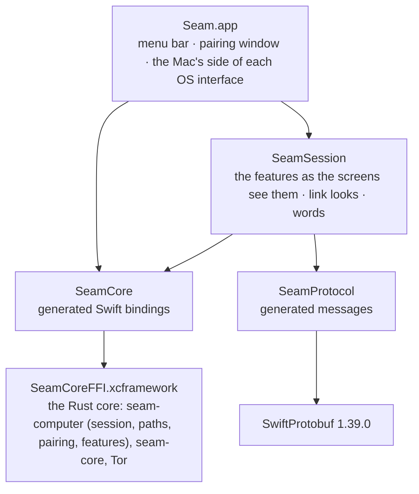

# Seam for Mac

A native macOS menu bar app in Swift 6 and SwiftUI, for macOS 14 and later. It shows your phone's notifications, syncs the clipboard, and shows the phone's battery and status; texts and files are planned. It follows macOS's own design and lives in the menu bar, with no Dock icon.

> **Status:** 0.2.4. Pairs with a phone by QR code, connects on the same Wi‑Fi or through Tor (a private onion service only the paired phone can find), syncs the clipboard both ways, shows the phone's battery in the menu bar, shows the phone's notifications as banners with reply and dismiss (settings in Settings › Notifications, on/off and pause in the popover), and keeps its keys sealed on disk under a Keychain key. The menu bar popover (board M01), pairing window (M02) and Settings with About (M03) follow the designs. Get it from [Releases](https://github.com/aveterosystems/seam/releases/latest).

## How it's put together



| Folder | What |
|---|---|
| `project.yml` | XcodeGen spec for the app target. The `.xcodeproj` is generated from it and never committed. |
| `Seam/App/` | Entry point and menu (`SeamApp.swift`), and `SeamController`: starts the core's `Computer` (`core/seam-computer`, decision 0014: the session, its paths, pairing, the features' logic and the saved settings) and turns its snapshots into what the screens show; the screens watch the features directly. Also `MacBattery`, the core's battery |
| `Seam/Storage/` | `Keychain` (the 32-byte storage key), as the core's `KeyStore` |
| `Seam/Pairing/` | The pairing window (board M02) and QR rendering |
| `Seam/Notifications/` | `PhoneNotifications`: the phone's notifications as banners, and what you do to them sent back; `BannerCentre`, the core's notification centre |
| `Seam/Clipboard/` | `SystemPasteboard` (the core's pasteboard) and the automatic clipboard setup |
| `Seam/UI/` | The popover, the main window (the phone's notifications and the clipboard history), Settings, and `Components.swift`: the shared pieces (module button, settings group and row) every screen is built from |
| `Packages/SeamSession/` | The features as the screens see them (`ClipboardFeature`, `NotificationsFeature`, `StatusFeature`: mirrors of the core's snapshot, passing what the user does back to it), `MacSameWifi` (the Bonjour announcement `_seam._tcp`, and which addresses are Wi‑Fi or wired), `LinkLook` and the status lines (`Looks`), the pairing window's states, the automatic clipboard setup's adb steps (`AdbSetup`), and their tests |
| `Packages/SeamCore/` | Swift bindings to the Rust core (`Sources/SeamCore/SeamCore.swift`, generated), the C header and module map (`FFI/include/`), and the tests |
| `Packages/SeamProtocol/` | The generated message types (`Sources/SeamProtocol/Generated/`) and the golden-vector tests |

## Building

**Needs:** Xcode 26 or later, [XcodeGen](https://github.com/yonaskolb/XcodeGen) 2.46 (`brew install xcodegen`), Rust (rustup) and `protoc` (`brew install protobuf`).

```bash
# 1. Build the Rust core as an XCFramework (rerun after changing core/)
scripts/build-mac-core.sh

# 2. Generate the Xcode project and open it
cd apps/mac
xcodegen generate
open Seam.xcodeproj
```

Run the **Seam** scheme. A Seam icon appears in the menu bar; click it to open the popover.

For a universal (Apple silicon and Intel) build of the core: `ARCHS="arm64 x86_64" scripts/build-mac-core.sh`.

## Trying it with a phone

Debug builds are **Seam Debug** (`com.avetero.seam.debug`), with their own data folder (`Application Support/Seam Debug`), Keychain item and pairing, so they run next to an installed Seam without touching it. Pair a phone with a debug build of the Android app the same way as a release. macOS asks once to allow local network access, for Same Wi‑Fi. macOS only lets an app post notifications from a normal location, so copy Seam Debug to `/Applications` to test them.

## Where things are kept

| What | Where |
|---|---|
| Identity, peers, Signal sessions, prekeys, the onion service's secret | `~/Library/Application Support/Seam/state.bin`, sealed with AES-256-GCM by the Rust core, file mode 0600 |
| Messages not yet delivered to the phone | `outbox.bin` next to it, sealed for the phone |
| The connection switches, the clipboard setting, the phone's pause and when it was paired | `preferences` next to it (not secrets). The first launch after 0.2.4 copies them across from the app's old preferences once |
| Tor's own state (directory cache, no keys) | `tor/` in the same folder |
| The key that seals it | The login Keychain, service `com.avetero.seam` (local to this Mac) |

A pairing made by an earlier relay version can't be reached over Tor: when this version first opens, it's forgotten (the identity stays) and the phone pairs again.

Seam never overwrites saved data it can't open. If `state.bin` is damaged or its Keychain key is gone, the menu offers **Reset Seam…**, which moves the old files aside (`state.bin.unreadable-<time>`) and starts over with new keys. To start over by hand: quit Seam, delete `state.bin`, and remove the `com.avetero.seam` item in Keychain Access. Unsigned dev builds may ask for Keychain access after each rebuild, because the code signature changes. Releases are signed with Seam's own certificate, so a new release should keep access without asking (to be confirmed across two real releases).

## Testing

```bash
scripts/build-mac-core.sh
swift test --package-path apps/mac/Packages/SeamCore       # the Rust core through the Swift bindings
swift test --package-path apps/mac/Packages/SeamProtocol   # the golden vector, shared with Android
swift test --package-path apps/mac/Packages/SeamSession    # the link looks, words, adb steps, Same Wi‑Fi
(cd core && cargo test -p seam-computer)                   # the session, both paths, pairing, features, the files
```

| Suite | What it proves |
|---|---|
| `SeamCoreTests` | Swift pairs through the Rust core (request, confirmation, PairAccept) and talks after a restart; an unconfirmed phone isn't saved; app data is sealed with the state; file chunks open only in order and a cut-short file fails |
| `GoldenVectorTests` | Swift decodes the shared golden vector byte for byte, re-encodes it to the same bytes, and `Hello` carries the connection policy |
| `seam-computer` (Rust, `core/seam-computer`) | Everything the session does, each test ported from the Swift tests this app had:<br/>**delivery**: sealed, saved, then sent; Same Wi‑Fi first; unacked messages go again, in order, when a link drops; switched-off paths never used, but a Hello always gets through; expired messages dropped; the outbox capped and reloaded after a restart<br/>**failover**: a link the phone's Hello doesn't list is closed and what it held goes on the other; a link that leaves a message unacked 8 s while another is up is given up<br/>**pairing**: each code is version 2 and names a new onion service; it lasts 5 minutes; cancel stops it; confirming swaps the old service for the new; a PairAccept never acked undoes the pairing; the code never prints<br/>**pause**: nothing but control is sent while paused, a copy made meanwhile never goes later, and a late or replayed pause can't re-pause a resumed Mac<br/>**Reconnect**: asked on every open link, never queued; a second tap does nothing; it shows for the usual connect time<br/>**features**: clipboard not echoed, sent only with sync on, password manager copies never sent; icons asked 40 at a time, once, PNGs only; dismiss-both; the battery clamp; forgetting the phone clears every feature<br/>**the Same Wi‑Fi listener** on real sockets: only the paired phone authenticates; strangers, slow and silent sockets are closed; idle sockets can't lock the phone out; only private and link-local addresses, on Wi‑Fi or wired interfaces; what was sent before a close still arrives<br/>**the paths**: carriers only while a phone is paired or pairing; a late close never takes away the carrier that replaced it<br/>**the files**: only a missing file looks like a first launch; a failed write keeps the old state; the outbox the Swift app wrote reads and writes back byte for byte; the old preferences are copied once<br/>**timers**: one that came due while the Mac slept fires on wake |
| `SameWifiTests` | Loopback, VPN tunnels and addresses this Mac doesn't have are never Same Wi‑Fi; a phone finds Seam on Bonjour under the fixed name "Seam" |
| `AdbSetupTests` | The automatic clipboard set-up finds `adb` only in known places, lists only authorised devices, and grants only the full build |
| `LinkLookTests`, `LooksTests` | Each path has its own line, icon and words; offline says why, including Tor being blocked; a pause comes first; no label trails off |

## Generated code

Don't edit these by hand. CI fails if they drift from their sources.

| File | Regenerate with |
|---|---|
| `Packages/SeamCore/Sources/SeamCore/SeamCore.swift`, `Packages/SeamCore/FFI/include/*` | `scripts/gen-bindings.sh` |
| `Packages/SeamProtocol/Sources/SeamProtocol/Generated/**` | `scripts/gen-protocol.sh` (needs `protoc-gen-swift` 1.39.0) |

## Planned

The Messages and Files windows, the Share extension and a Finder File Provider, each as a feature module behind the shared `Feature` interface. Moving the storage key to the data-protection keychain, wrapped by a Secure Enclave key, which needs an Apple Developer signature. Releases are signed with Seam's own certificate but not notarized, so the first download needs Open Anyway once; notarization comes with an Apple Developer account.

## Updates

Release builds update through [Sparkle](https://sparkle-project.org) 2.10.0, pinned by commit in `Package.resolved`. Sparkle asks once whether to check; then once a day (Settings › About can turn it off) Seam reads `appcast.xml` from the latest GitHub release. Sparkle requires the feed itself to be signed (`SURequireSignedFeed`, with no fallback) and the update to be signed with Seam's update key (`SUPublicEDKey` in `Config/Release-Info.plist`). That key is the root of trust for Mac updates: Sparkle doesn't also compare the new app's certificate. It asks before installing; nothing installs automatically. Debug builds don't update.

Releases are signed with `Config/Release.entitlements`, which turns off library validation: a certificate without an Apple Team ID can't otherwise load Sparkle.framework.
