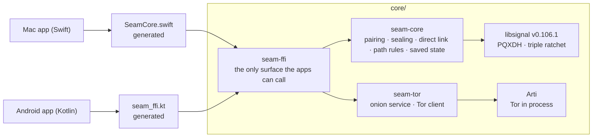
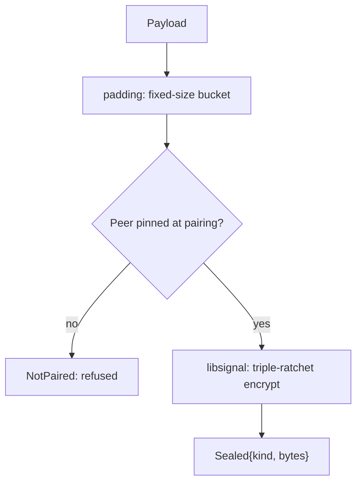

# Seam core

Everything in Seam that touches a key, and the rules both apps must agree on, live here: written once in Rust and shared by the Mac and Android apps. The cryptography is Signal's [libsignal](https://github.com/signalapp/libsignal); the Tor connection is the Tor Project's [Arti](https://arti.torproject.org).



## Crates

| Crate | What it does |
|---|---|
| **`seam-core`** | A device's identity and Signal sessions, plus Seam's own layer on top: pairing and identity pinning, sealing envelopes, padding, the prekey bundle byte format, file chunk sealing, the encrypted direct link (`LanChannel`), which path a message may take, and the sealed saved state |
| **`seam-tor`** | Seam's Tor path on Arti: the Mac's private onion service (restricted discovery, so only the paired phone can find it), the phone's connection to it, and the two 32-byte secrets behind them. Keys live only in memory (Arti's in-memory keystore); the apps keep them in their sealed state. Arti is pinned to one exact version because restricted discovery and the in-memory keystore are behind its experimental features. Nothing here logs |
| **`seam-ffi`** | The API the apps see: `SeamDevice` (identity, pairing, sealing, Hello and routing, saved state), the feature catalogue, the clipboard rules, `LanChannel` (the direct link), `Tor` and `TorStream` (Tor as a byte pipe), and `FileSealer` / `FileReceiver`. Plain bytes and strings in and out. UniFFI generates the Swift and Kotlin code from it |

### `seam-core` modules

| Module | Responsibility |
|---|---|
| `device.rs` | Creates the identity, pins peers, builds signed prekey bundles (with a Kyber-1024 post-quantum prekey), starts sessions with PQXDH, and encrypts and decrypts through the triple ratchet |
| `pairing.rs` | Both sides of QR pairing: the one-time token, `PairRequest` checks, confirm and reject, and the 6-digit safety code |
| `envelope.rs` | Seals a payload into an `Envelope` and opens one, with every routing field bound inside the encryption; refuses unknown senders and other devices' envelopes, and reports duplicates |
| `lan.rs` | `LanChannel`, the direct link over any byte stream (Same Wi‑Fi or Tor): Noise NN, then each side signs the handshake hash; a pairing phone proves the token instead |
| `links.rs` | Which path may carry a message (Same Wi‑Fi first, then Tor, only paths on at both ends), applying a Hello, and the app's saved data (the Tor secret and onion address, Hello counters). Older relay-era data isn't read, so those devices pair again |
| `state.rs` | Saves and restores a device, sealed with AES-256-GCM under the app's storage key |
| `relay.rs` | Each device's Ed25519 key, which addresses envelopes and signs the direct link. The name, and its login signature, are left from the relay |
| `padding.rs` | Pads every message to a fixed bucket (1 KB · 16 KB · 256 KB · 1 MB) so sizes give nothing away |
| `bundle.rs` | A versioned byte format for prekey bundles. libsignal re-verifies every signature when a session starts |
| `file.rs` | AES-256-GCM file chunks, bound to the file id, the chunk index and a last-chunk flag |
| `proto.rs` | The Protobuf messages the core reads and writes, generated from `protocol/`, and its own saved-state format (`proto/state.proto`) |
| `error.rs` | One error type; the apps see `NotPaired`, `UntrustedIdentity`, `NotConfirmed`, `Duplicate`, `PairingFailed`, `BadState` or `Invalid` |
| `hello.rs` | Builds and applies the Hello: switches, open links, the pause and capabilities. The peer's capabilities are kept in the app data |
| `catalogue.rs` | Each feature's delivery rules (time limit, latest only, lazy, stopped by a pause), the one table both outboxes ask |
| `features/` | Each feature's own rules, one module per feature: `clipboard` today |

### Features

Each feature's shared rules live in `seam-core/src/features/<feature>/` (the clipboard so far), named like its `protocol/seam/v1/<feature>.proto`, with a matching `seam-ffi/src/<feature>.rs` and app module. Delivery rules for every feature are one table in `catalogue.rs`. The rules for this code:

- A feature with no rules to share (a single message) has no folder here, only its `.proto`.
- A feature uses only the core's public sealing and link code.
- **A feature never uses another feature's code.** If two need the same thing, it moves into the shared core.
- Copies kept on the computer (messages, contacts, call log) go through a shared `seam-core/src/store/`; the app supplies only the key.

## What Seam adds to libsignal



- **Never trust on first use.** Plain libsignal accepts a peer's key the first time it sees it. Seam refuses any peer that wasn't pinned from the pairing QR code.
- **Padding before encryption**, so ciphertext length doesn't reveal message length.
- **A byte format for bundles**, which libsignal doesn't provide.
- **File chunk sealing** for transfers that go outside the Signal session.

There are no new cryptographic primitives. Everything is libsignal or audited RustCrypto code.

## Build and test

```bash
cd core
cargo test                                  # every security property (no network needed)
cargo test -p seam-tor --test live -- --ignored --nocapture   # seam-tor on the live Tor network (~2 min)
cargo clippy --all-targets -- -D warnings
cargo fmt --check
```

- The toolchain is pinned in `rust-toolchain.toml` (the version libsignal is tested with), so rustup installs it automatically.
- libsignal's post-quantum ratchet needs **`protoc`** at build time: `brew install protobuf` or `apt install protobuf-compiler`.

### What the tests prove

A sample of the most important ones:

| Test | Property |
|---|---|
| `messages_flow_both_ways_after_pqxdh_setup` | Sessions work both ways through many ratchet steps |
| `impostor_bundle_is_refused` | A bundle from a different identity than the pinned one fails with `UntrustedIdentity` |
| `unpaired_peers_are_refused` | No session with a peer that wasn't pinned |
| `replayed_message_is_rejected`, `tampered_message_is_rejected` | Replays and changed bytes fail |
| `out_of_order_delivery_still_decrypts` | Messages can arrive in any order |
| `one_time_prekey_is_used_up` | A one-time prekey can't be used twice |
| `ciphertext_size_does_not_reveal_message_length` | Padding works end to end |
| `tampered_signature_fails_when_the_session_starts` | A bundle with an altered signature is refused |
| `receiver_catches_reordering_truncation_swaps_and_tampering` | File chunks can't be moved, cut short, swapped or altered |
| `wrong_token_is_refused_and_leaves_no_peer`, `code_is_single_use`, `expired_code_is_refused` | A pairing code works once, only within its time, and a wrong one changes nothing |
| `safety_code_changes_if_a_key_is_swapped` | Swapping a key during pairing shows on the safety code |
| `sr_2_10_every_routing_field_is_bound_inside_the_encryption` | An envelope can't be re-addressed or moved |
| `paired_devices_authenticate_and_exchange_frames`, `a_stranger_is_refused_on_both_sides` | Only the paired devices can open a direct link |
| `a_phone_that_scanned_the_code_opens_a_pairing_channel`, `a_pairing_phone_refuses_a_mac_other_than_the_one_on_the_code` | A pairing channel needs the code, and only reaches the Mac on it |
| `tampering_replay_and_garbage_close_the_channel` | Anything wrong on a direct link closes it |
| `allowed_paths_table`, `hellos_apply_only_when_newer` | Only paths on at both ends are used, and an old Hello can't switch one back on |
| `earlier_relay_formats_are_not_read_so_the_devices_pair_again` | Relay-era saved data is refused cleanly |
| `wrong_key_and_any_tampering_fail`, `two_exports_never_reuse_a_nonce` | Saved state opens only with its key and is never sealed twice under one nonce |
| `secrets_never_print`, `an_address_never_debug_prints` | Tor keys and onion addresses never reach a log |
| `seam-tor/tests/live.rs` (by hand) | On the live Tor network: only the paired phone can find the Mac's service, and Tor keys never touch the disk |

## Bindings

The apps never call Rust directly. After changing `seam-ffi`'s API, regenerate the bindings:

```bash
scripts/gen-bindings.sh     # → apps/mac/Packages/SeamCore and apps/android/core/crypto
```

The generated code is committed, and CI fails if it drifts from `seam-ffi`. Names come from `seam-ffi/uniffi.toml`: the Swift module is `SeamCore`, the Kotlin package is `com.avetero.seam.crypto`.

## Updating libsignal

libsignal is pinned to a release tag in `seam-core/Cargo.toml`. To update it: bump the tag, match `rust-toolchain.toml` to libsignal's own `rust-toolchain`, run the full test suite here and in both apps, and note the version in the release notes.
