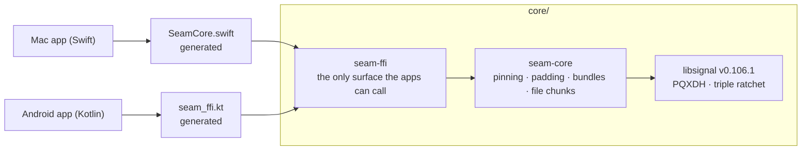
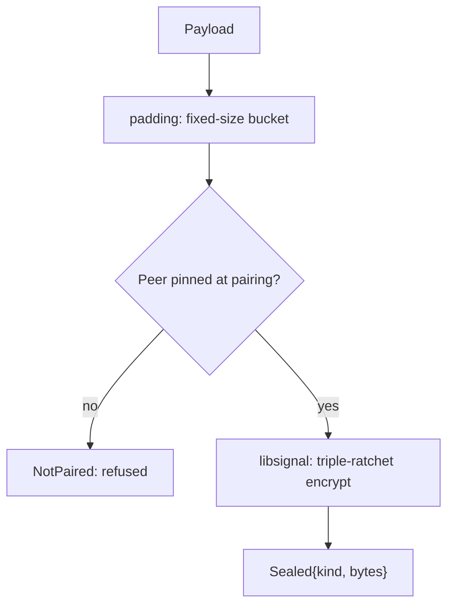

# Seam crypto core

Everything in Seam that touches a key lives here, written once in Rust and shared by the Mac and Android apps. It's a thin layer over Signal's [libsignal](https://github.com/signalapp/libsignal), which does the actual cryptography.



## Crates

| Crate | What it does |
|---|---|
| **`seam-core`** | A device's identity and Signal sessions, plus Seam's own layer on top: identity pinning, padding, the prekey bundle byte format and file chunk sealing |
| **`seam-tor`** | **Proposal, not used by the apps yet** (planning notes, decision 0009). Seam's Tor path on Arti: the Mac's private onion service (restricted discovery), the phone's connection to it, and the two 32-byte secrets behind them. Keys live only in memory (Arti's in-memory keystore); the apps keep them in their sealed data. Arti is pinned to one exact version because restricted discovery and the in-memory keystore are behind its experimental features |
| **`seam-ffi`** | The API the apps see: `SeamDevice` and a few file-chunk functions. Plain bytes and strings in and out. UniFFI generates the Swift and Kotlin code from it. |

### `seam-core` modules

| Module | Responsibility |
|---|---|
| `device.rs` | Creates the identity, pins peers, builds signed prekey bundles (with a Kyber-1024 post-quantum prekey), starts sessions with PQXDH, and encrypts and decrypts through the triple ratchet |
| `padding.rs` | Pads every message to a fixed bucket (1 KB · 16 KB · 256 KB · 1 MB) so sizes give nothing away |
| `bundle.rs` | A versioned byte format for prekey bundles, so they can be stored on the relay. libsignal re-verifies every signature when a session starts. |
| `file.rs` | AES-256-GCM file chunks, bound to the file id, the chunk index and a last-chunk flag |
| `links.rs` | Which path may carry a message (decision 0006: Same Wi‑Fi first, then the relay, only paths on at both ends), applying a Hello, and the app's saved data (relay group, owner key, Hello counters). Reads both apps' earlier formats. |
| `error.rs` | One error type; the apps see `NotPaired`, `UntrustedIdentity` or `Invalid` |

### Features

Each feature's messages, rules and states live in `seam-core/src/features/<feature>/` (decision 0011), with the same name as its `protocol/seam/v1/<feature>.proto`, its `seam-ffi/src/<feature>.rs` and the apps' feature modules. The rules:

- A feature with no rules to share (a single message) has no folder here, only its `.proto`.
- A feature uses only the core's public sealing and link code.
- **A feature never uses another feature's code.** If two need the same thing, it moves into the shared core.
- Copies kept on the computer (messages, contacts, call log) go through `seam-core/src/store/`; the app supplies only the key.

Review checks these; the compiler doesn't.

## What Seam adds to libsignal



- **Never trust on first use.** Plain libsignal accepts a peer's key the first time it sees it. Seam refuses any peer that wasn't pinned from the pairing QR code.
- **Padding before encryption**, so ciphertext length doesn't reveal message length.
- **A byte format for bundles**, which libsignal doesn't provide.
- **File chunk sealing** for transfers that go outside the Signal session.

There are no new cryptographic primitives. Everything is libsignal or audited RustCrypto code.

## Build and test

```bash
cd core
cargo test                                  # every security property
cargo test -p seam-tor --test live -- --ignored --nocapture   # seam-tor on the live Tor network (~2 min)
cargo clippy --all-targets -- -D warnings
cargo fmt --check
```

- The toolchain is pinned in `rust-toolchain.toml` (the version libsignal is tested with), so rustup installs it automatically.
- libsignal's post-quantum ratchet needs **`protoc`** at build time: `brew install protobuf` or `apt install protobuf-compiler`.

### What the tests prove

| Test | Property |
|---|---|
| `messages_flow_both_ways_after_pqxdh_setup` | Sessions work both ways through many ratchet steps |
| `impostor_bundle_is_refused` | A bundle from a different identity than the pinned one fails with `UntrustedIdentity` |
| `unpaired_peers_are_refused` | No session with a peer that wasn't pinned |
| `replayed_message_is_rejected`, `tampered_message_is_rejected` | Replays and changed bytes fail |
| `out_of_order_delivery_still_decrypts` | Messages can arrive in any order |
| `one_time_prekey_is_used_up` | A one-time prekey can't be used twice |
| `ciphertext_size_does_not_reveal_message_length` | Padding works end to end |
| `tampered_signature_fails_when_the_session_starts` | A bundle with an altered signature is refused |
| `rejects_reordering_truncation_swaps_and_tampering` | File chunks can't be moved, cut short, swapped or altered |

## Bindings

The apps never call Rust directly. After changing `seam-ffi`'s API, regenerate the bindings:

```bash
scripts/gen-bindings.sh     # → apps/mac/Packages/SeamCore and apps/android/core/crypto
```

The generated code is committed, and CI fails if it drifts from `seam-ffi`. Names come from `seam-ffi/uniffi.toml`: the Swift module is `SeamCore`, the Kotlin package is `com.avetero.seam.crypto`.

## Updating libsignal

libsignal is pinned to a release tag in `seam-core/Cargo.toml`. To update it: bump the tag, match `rust-toolchain.toml` to libsignal's own `rust-toolchain`, run the full test suite here and in both apps, and note the version in the release notes.
