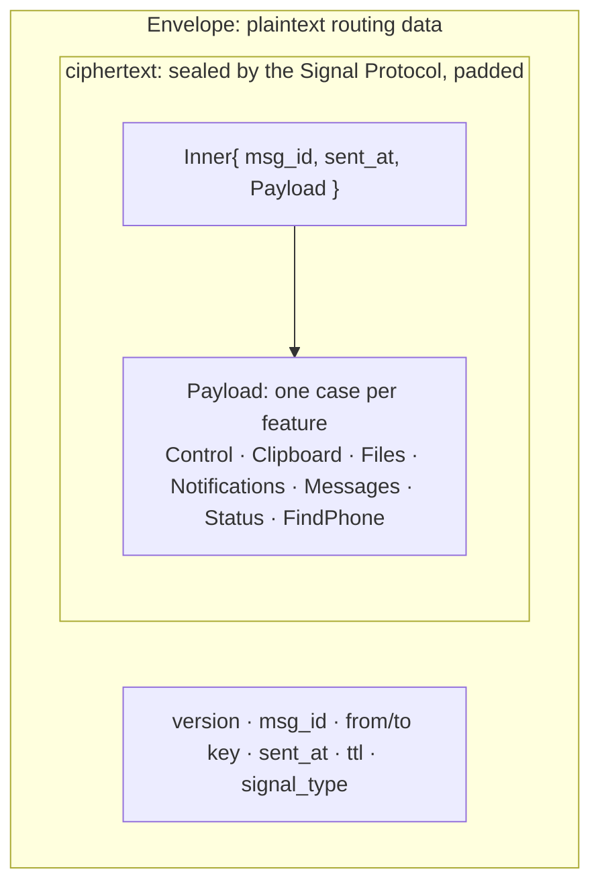
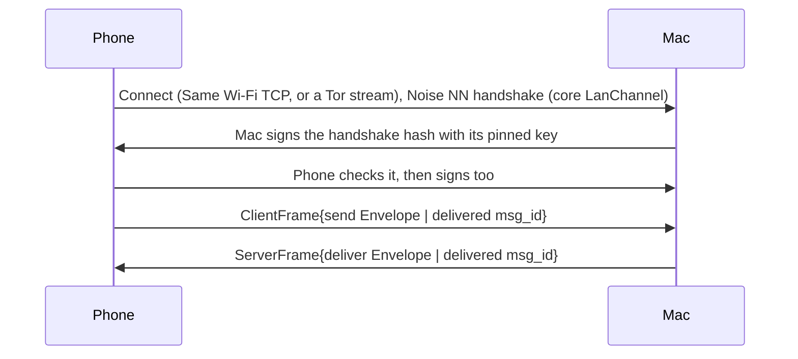

# Seam protocol

The one message format every part of Seam speaks, written in Protobuf and generated for Swift (Mac) and Kotlin (Android).

## Two layers



- The **`Envelope`** carries only routing data. There's deliberately no "kind" field, so nothing that carries it can tell a clipboard from a text message. `from` and `to` are each device's Ed25519 key, called `relay_key` in the schema (a name left from the relay).
- **`Inner`** repeats the envelope's routing fields inside the encryption. The receiver drops a message if they don't match, so a ciphertext can't be moved under another envelope.
- **`Payload`** has one `oneof` case per feature, with each feature owning a block of ten field numbers.

Every envelope also travels inside the direct link's own encryption (below), so the network sees only padded noise.

## Files

| File | Messages |
|---|---|
| `seam/v1/envelope.proto` | `Envelope` |
| `seam/v1/payload.proto` | `Inner`, `Payload` (the `oneof` of every feature) |
| `seam/v1/control.proto` | `Hello` (capabilities, allowed transports, open links and the phone's pause), `Ack`, `Ping`, `Unpair`, `PairRequest`, `PairAccept` |
| `seam/v1/relay.proto` | `ClientFrame` and `ServerFrame`, the frames inside a direct link. The relay's own messages (`Login`, `Challenge` and the rest) are no longer used by the apps |
| `seam/v1/clipboard.proto` | `Clipboard` |
| `seam/v1/files.proto` | `FileOffer`, `FileAnswer`, `FileChunkRef`, `FileDone` |
| `seam/v1/notifications.proto` | `Notification`, `NotificationButton`, `NotificationAction`, and the phone-owned settings: `NotificationSettings`, `NotificationApp`, `NotificationMode`, `NotificationSettingsChange` |
| `seam/v1/messages.proto` | `MessageSync`, `MessageThread`, `TextMessage`, `MessageSend` |
| `seam/v1/status.proto` | `Status` |
| `seam/v1/find_phone.proto` | `FindPhone` |
| `testdata/` | [Golden vectors](testdata/README.md), decoded identically by every codebase's tests |

## The direct link

The phone always connects to the Mac, never the other way round, over one of two carriers:

- **Same Wi‑Fi:** a TCP connection to the Mac on the local network. The Mac announces itself over Bonjour as `_seam._tcp`, service name "Seam", with no TXT data.
- **Tor:** a stream through Tor (Arti, inside the app) to the Mac's private onion service. The service uses restricted discovery, so only the paired phone, which holds the discovery secret, can even find it.

Both carriers run the same encrypted channel. Nothing on the network, and nothing in Tor, can read, change, replay or inject anything, and only the paired devices can connect.



- **All of the cryptography is in the core** (`LanChannel` in `core/seam-core/src/lan.rs`): `Noise_NN_25519_ChaChaPoly_BLAKE2s`, then each side signs `"seam-lan-v1 responder|initiator" || handshake hash` with the Ed25519 key pinned at pairing. The Mac proves itself first, so a fake Mac learns nothing about the phone. The apps only move bytes: write `start()` on connect, feed every read to `receive()`, write back `send`, and close the connection on any error.
- **Frames inside:** only `ClientFrame.send` and `ClientFrame.delivered` from the phone, and `ServerFrame.deliver` and `ServerFrame.delivered` from the Mac (plus the bundle exchange on a pairing channel, below). Anything else is ignored. There's no `Challenge`/`Login`: the channel is already authenticated.
- **Limits:** the Mac closes a connection unless its first bytes arrive within 2 seconds and authentication finishes within 10 on Same Wi‑Fi, or 15 and 45 through Tor, which is slower; the phone waits up to 10 and 90 seconds. On Same Wi‑Fi the Mac holds at most 16 unauthenticated connections (4 per address, or per IPv6 /64 outside link-local); when full, it drops a random one, silent ones first. It keeps one authenticated connection per phone and carrier (a new one replaces the old). On Same Wi‑Fi the phone only connects to private or link-local addresses, tries at most 8 services at once, and skips one for 10 minutes only after a valid proof from a different key; anything else is retried after 30 seconds. Frames are at most 1.2 MB.
- **What this can't stop:** someone on your Wi‑Fi can always slow or block the direct path (flooding the Mac, fake adverts, or simply jamming the radio). These limits keep that costly and bounded, and Tor still works if it's allowed. A network can block Tor; the app then says why. Nothing either can do lets anyone read, change or inject a message, or make a device use a path it switched off.
- **Delivery, both ways:** each side keeps every envelope it sends until the other's `Delivered` (`ClientFrame.delivered` from the phone, `ServerFrame.delivered` from the Mac, sent once the envelope is handled and saved). If the link drops first, it's sent again on whatever path is allowed next, and duplicates are dropped by id. Both outboxes survive a restart.
- The inner envelopes are the same Signal Protocol messages as everywhere else, so the post-quantum protection is unchanged. The outer Noise layer is classical (X25519), and it protects only what the envelope already exposes.

## Which paths may be used

Each device has a switch per path (`Transport` in `control.proto`: `TRANSPORT_LAN` and `TRANSPORT_TOR`; `TRANSPORT_RELAY` is retired and never reused). Every time a path to the peer comes up, and whenever the switches change, each device sends a sealed `Hello` with its `allowed_transports`. It applies a `Hello` only if its `seq` is higher than the last one applied (a counter, not a clock, so a delayed old `Hello` can't switch a path back on), remembers the peer's latest list, and treats a peer it has never heard from, or a `Hello` with an empty list (older versions), as allowing everything; a list naming only paths this version can't use means nothing in common. These rules live once, in `core/seam-core` (`links`), and both apps call them. A device opens and listens on every path its **own** switches allow, but only sends messages over a path allowed at **both** ends, Same Wi‑Fi first. The exceptions are `Hello` and the farewell `Unpair`, which may go over any path the sender allows, so a change of switches can always reach the peer: otherwise two devices that each remember the other's old choice could never reach each other again. A `Hello` carries only the switches, sealed like any message. It never quietly falls back: a message with no allowed path waits in the outbox, and the app says why. At least one switch always stays on.

## A link that dies without closing

A link can die without either end being told: the phone leaves the Wi‑Fi, the Mac sleeps, a router drops idle connections. TCP takes minutes to notice, and until it does each device would keep preferring the dead link. Two rules give it up in seconds:

- **Open links.** Every `Hello` lists `open_links`: the links the sender has open to the peer right now. A device also sends a `Hello` whenever a link closes while another stays open. The receiver closes any link of its own that the peer's latest `Hello` doesn't list, and sends what that link never confirmed on another. A `Hello` without `open_links` (an older app) closes nothing.
- **Ack timeout.** A message left unacked for 8 seconds on one link, while another link is up, means that link is dead: it's closed and the message goes on the other. With one link, the link's own timeouts decide.

The core re-encodes each payload when it seals it, so a new field reaches the peer only once both apps' cores are built with it.

## The pairing QR code

The Mac shows this; the phone scans it. Binary values are base64url without padding; text values are percent-encoded.

```
seam://pair?v=2&o=<onion address>&d=<discovery secret>&t=<token>&i=<identity key>&k=<channel key>&n=<Mac name>
```

| Key | Value |
|---|---|
| `v` | QR format version, `2`. Version 1 (a relay code) is refused: those devices update and pair again |
| `o` | The address of a new onion service, made for this pairing |
| `d` | The phone's 32-byte restricted-discovery secret: only it can find that service |
| `t` | The 32-byte one-time pairing token |
| `i` | The Mac's Signal identity key (33 bytes), which the phone pins |
| `k` | The Mac's 32-byte Ed25519 key, which pins the channel and addresses envelopes |
| `n` | The Mac's display name |

Each code names a new onion service, so a phone that's removed later only knows a dead address.

## Pairing

The phone tries Same Wi‑Fi and the code's onion service at once; the first to connect becomes the **pairing channel**, and only one is used. A pairing phone has no key the Mac knows yet, so instead of signing it proves it scanned the code: an HMAC of the handshake hash keyed with the token (`"seam-lan-v1 pairing"`). The Mac still signs first, and the phone checks it's the Mac on the code. A pairing channel carries only the pairing exchange:

1. The phone asks for the Mac's prekey bundle (`ClientFrame.get_bundle`) and gets it (`ServerFrame.bundle`).
2. It calls `pair_with` and sends the resulting envelope, whose `PairRequest` carries the token. The Mac's `accept_pairing` checks it (the token inside stays the authority), and both screens show the safety code.
3. Once you confirm on the Mac, it saves the pairing, then sends `PairAccept`. If the phone hasn't acked it within 60 seconds, or the channel drops first, the Mac undoes the pairing.

A code lasts 5 minutes; the phone gives up after 3 minutes without finding the Mac. After pairing, the phone reconnects as itself, on the same service.

## Field number blocks

| Numbers | Owner |
|---|---|
| 1–9 | Control |
| 10–19 | Clipboard |
| 20–29 | Files |
| 30–39 | Notifications |
| 40–49 | Messages |
| 50–59 | Status |
| 60–69 | Find my phone |
| 70+ | The next new feature takes the next free block |

## Rules

1. **Never reuse or renumber a field.** Mark removed fields `reserved`.
2. **Adding** fields, messages or `oneof` cases is always safe. Older apps ignore what they don't know.
3. **A change of meaning is a new field**, never an edited one.
4. `Envelope.version` changes only for a break in the envelope or the encryption itself.
5. **No new plaintext `Envelope` field** that reveals content, type, real size or device identity.

## Generating code

```bash
scripts/gen-protocol.sh
```

| Target | Generator | Output |
|---|---|---|
| Swift | `protoc-gen-swift` 1.39.0 | `apps/mac/Packages/SeamProtocol/Sources/SeamProtocol/Generated/` (committed) |
| Kotlin | `protobuf-kotlin` lite, through Gradle | Generated at build time by `apps/android/core/protocol` |

CI runs `buf format` and `buf lint` on every change, checks that the committed Swift code matches the schema, and decodes the golden vectors in the Mac and Android tests.

## Linting locally

```bash
cd protocol
npx @bufbuild/buf format --diff --exit-code
npx @bufbuild/buf lint
```
