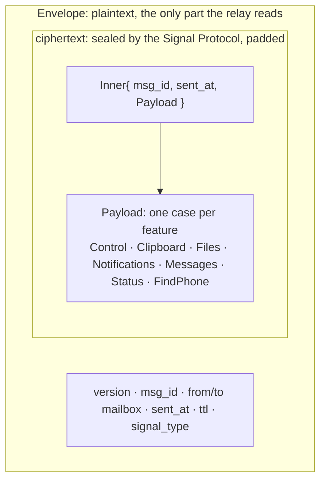
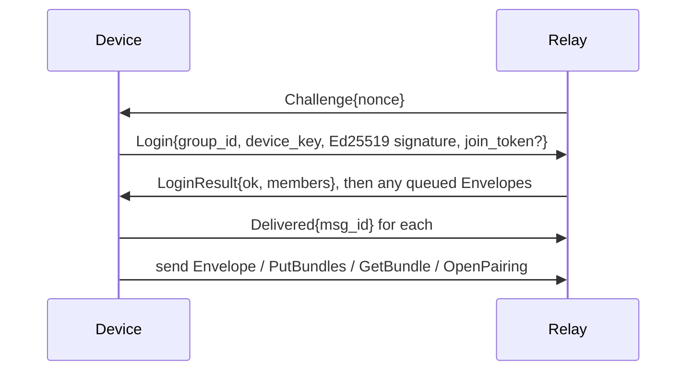

# Seam protocol

The one message format every part of Seam speaks, written in Protobuf and generated for Swift (Mac), Kotlin (Android) and TypeScript (relay).

## Two layers



- The **`Envelope`** carries only routing data. There's deliberately no "kind" field, so the relay can't tell a clipboard from a text message.
- **`Inner`** repeats the envelope's `msg_id` and `sent_at` inside the encryption. The receiver drops a message if they don't match, so the relay can't move a ciphertext under another envelope.
- **`Payload`** has one `oneof` case per feature, with each feature owning a block of ten field numbers.

## Files

| File | Messages |
|---|---|
| `seam/v1/envelope.proto` | `Envelope` |
| `seam/v1/payload.proto` | `Inner`, `Payload` (the `oneof` of every feature) |
| `seam/v1/control.proto` | `Hello` (capabilities and allowed transports), `Ack`, `Ping`, `Unpair`, `PairRequest`, `PairAccept` |
| `seam/v1/clipboard.proto` | `Clipboard` |
| `seam/v1/files.proto` | `FileOffer`, `FileAnswer`, `FileChunkRef`, `FileDone` |
| `seam/v1/notifications.proto` | `Notification`, `NotificationButton`, `NotificationAction` |
| `seam/v1/messages.proto` | `MessageSync`, `MessageThread`, `TextMessage`, `MessageSend` |
| `seam/v1/status.proto` | `Status` |
| `seam/v1/find_phone.proto` | `FindPhone` |
| `testdata/` | [Golden vectors](testdata/README.md), decoded identically by every codebase's tests |

## The relay connection

Each device keeps one WebSocket to the relay: `wss://<relay>/v1/connect?group=<group id>`, carrying one `ClientFrame` or `ServerFrame` per binary message (`relay.proto`).



## The pairing QR code

The Mac shows this; the phone scans it. Binary values are base64url without padding.

```
seam://pair?v=1&r=<relay URL>&g=<group id>&t=<token>&i=<identity key>&k=<relay key>&n=<Mac name>
```

| Key | Value |
|---|---|
| `v` | QR format version, `1` |
| `r` | The relay's WebSocket base URL, percent-encoded (e.g. `wss://relay.seam.example`) |
| `g` | The 16-byte group id |
| `t` | The 32-byte one-time pairing token (the relay only ever gets its SHA-256) |
| `i` | The Mac's Signal identity key (33 bytes), which the phone pins |
| `k` | The Mac's 32-byte relay key, to address envelopes and fetch its bundle |
| `n` | The Mac's display name, percent-encoded |

The phone then: logs in to group `g` with `join_token = t`, fetches the Mac's bundle with `GetBundle{k}`, calls `pair_with`, and sends the resulting envelope. The Mac's `accept_pairing` checks it, both screens show the safety code, and the Mac sends `PairAccept` once you confirm.

## Field number blocks

| Numbers | Owner |
|---|---|
| 1–9 | Control |
| 10–19 | Clipboard |
| 20–29 | Files |
| 30–39 | Notifications |
| 40–49 | Messages |
| 50–59 | Status |
| 60–69 | Find my phone |
| 70+ | The next new feature takes the next free block |

## Rules

1. **Never reuse or renumber a field.** Mark removed fields `reserved`.
2. **Adding** fields, messages or `oneof` cases is always safe. Older apps ignore what they don't know.
3. **A change of meaning is a new field**, never an edited one.
4. `Envelope.version` changes only for a break in the envelope or the encryption itself.
5. **No new plaintext `Envelope` field** that reveals content, type, real size or device identity.

## Generating code

```bash
scripts/gen-protocol.sh
```

| Target | Generator | Output |
|---|---|---|
| Swift | `protoc-gen-swift` 1.39.0 | `apps/mac/Packages/SeamProtocol/Sources/SeamProtocol/Generated/` (committed) |
| TypeScript | `protoc-gen-es` | `server/src/generated/` (committed) |
| Kotlin | `protobuf-kotlin` lite, through Gradle | Generated at build time by `apps/android/core/protocol` |

CI runs `buf format` and `buf lint` on every change, checks that the committed Swift code matches the schema, and decodes the golden vectors on all three platforms.

## Linting locally

```bash
cd protocol
npx @bufbuild/buf format --diff --exit-code
npx @bufbuild/buf lint
```
