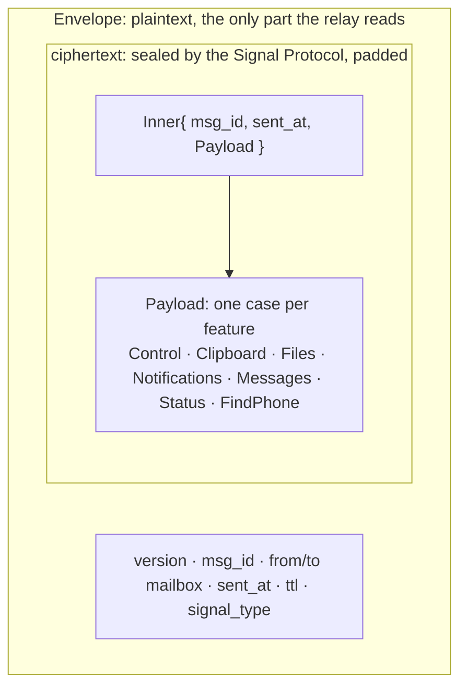
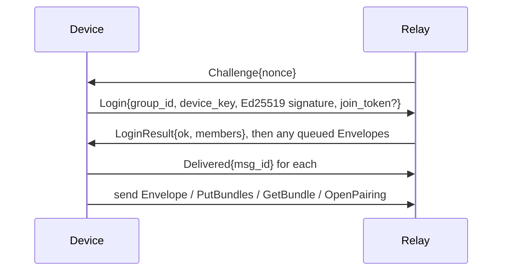
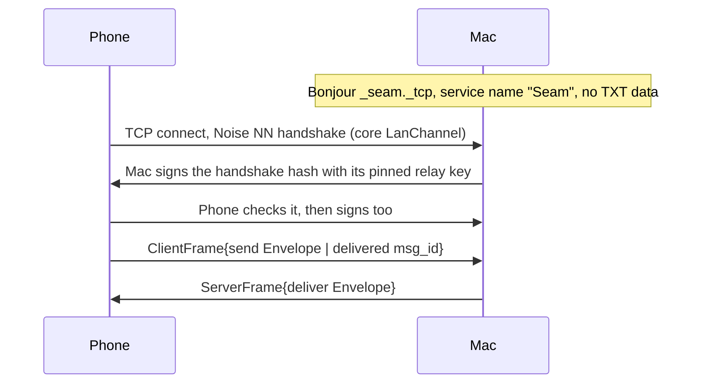

# Seam protocol

The one message format every part of Seam speaks, written in Protobuf and generated for Swift (Mac), Kotlin (Android) and TypeScript (relay).

## Two layers



- The **`Envelope`** carries only routing data. There's deliberately no "kind" field, so the relay can't tell a clipboard from a text message.
- **`Inner`** repeats the envelope's `msg_id` and `sent_at` inside the encryption. The receiver drops a message if they don't match, so the relay can't move a ciphertext under another envelope.
- **`Payload`** has one `oneof` case per feature, with each feature owning a block of ten field numbers.

## Files

| File | Messages |
|---|---|
| `seam/v1/envelope.proto` | `Envelope` |
| `seam/v1/payload.proto` | `Inner`, `Payload` (the `oneof` of every feature) |
| `seam/v1/control.proto` | `Hello` (capabilities, allowed transports and the phone's pause), `Ack`, `Ping`, `Unpair`, `PairRequest`, `PairAccept` |
| `seam/v1/clipboard.proto` | `Clipboard` |
| `seam/v1/files.proto` | `FileOffer`, `FileAnswer`, `FileChunkRef`, `FileDone` |
| `seam/v1/notifications.proto` | `Notification`, `NotificationButton`, `NotificationAction`, and the phone-owned settings: `NotificationSettings`, `NotificationApp`, `NotificationMode`, `NotificationSettingsChange` |
| `seam/v1/messages.proto` | `MessageSync`, `MessageThread`, `TextMessage`, `MessageSend` |
| `seam/v1/status.proto` | `Status` |
| `seam/v1/find_phone.proto` | `FindPhone` |
| `testdata/` | [Golden vectors](testdata/README.md), decoded identically by every codebase's tests |

## The relay connection

Each device keeps one WebSocket to the relay: `wss://<relay>/v1/connect?group=<group id>`, carrying one `ClientFrame` or `ServerFrame` per binary message (`relay.proto`).



## The direct connection (same Wi‑Fi)

When both devices allow **Same Wi‑Fi**, the phone also connects straight to the Mac. Nothing on the network can read, change, replay or inject anything, and only the paired devices can connect.



- **All of the cryptography is in the core** (`LanChannel` in `core/seam-core/src/lan.rs`): `Noise_NN_25519_ChaChaPoly_BLAKE2s`, then each side signs `"seam-lan-v1 responder|initiator" || handshake hash` with the Ed25519 relay key pinned at pairing. The Mac proves itself first, so a fake Mac learns nothing about the phone. The apps only move bytes: write `start()` on connect, feed every read to `receive()`, write back `send`, and close the socket on any error.
- **Frames inside are the relay's own:** only `ClientFrame.send` and `ClientFrame.delivered` from the phone, and `ServerFrame.deliver` and `ServerFrame.delivered` from the Mac. Anything else is ignored. There's no `Challenge`/`Login`: the channel is already authenticated.
- **Limits:** the first bytes must arrive within 2 seconds and authentication must finish within 10, or the socket is closed. The Mac holds at most 16 unauthenticated connections (4 per address, or per IPv6 /64 outside link-local); when full, it drops a random one, silent ones first. It keeps one authenticated connection per phone (a new one replaces the old). The phone only connects to private or link-local addresses, tries at most 8 services at once, and skips one for 10 minutes only after a valid proof from a different key; anything else is retried after 30 seconds. Frames are at most 1.2 MB, like the relay's.
- **What this can't stop:** someone on your Wi‑Fi can always slow or block the direct path (flooding the Mac, fake adverts, or simply jamming the radio). These limits keep that costly and bounded, and the relay still works if it's allowed. Nothing they do lets them read, change or inject a message, or make a device use a path it switched off.
- **Delivery, both ways:** each side keeps every envelope it sends directly until the other's `Delivered` (`ClientFrame.delivered` from the phone, `ServerFrame.delivered` from the Mac, sent once the envelope is handled and saved). If the connection drops first, it's sent again on whatever path is allowed next, and duplicates are dropped by id. The Mac's outbox survives a restart.
- The inner envelopes are the same Signal Protocol messages as everywhere else, so the post-quantum protection is unchanged. The outer Noise layer is classical (X25519), and it protects only what the envelope already exposes.

## Which paths may be used

Each device has a switch per path (`Transport` in `control.proto`; decision 0006). Every time a path to the peer comes up, and whenever the switches change, each device sends a sealed `Hello` with its `allowed_transports`. It applies a `Hello` only if its `seq` is higher than the last one applied (a counter, not a clock, so a delayed old `Hello` can't switch a path back on), remembers the peer's latest list, and treats a peer it has never heard from, or a `Hello` with an empty list (older versions), as allowing everything; a list naming only paths this version can't use means nothing in common. These rules live once, in `core/seam-core` (`links`), and both apps call them. A device opens and listens on every path its **own** switches allow, but only sends messages over a path allowed at **both** ends. The exceptions are `Hello` and the farewell `Unpair` (and the relay's own acks), which may go over any path the sender allows, so a change of switches can always reach the peer: otherwise two devices that each remember the other's old choice could never reach each other again. A `Hello` carries only the switches, sealed like any message. It never quietly falls back: a message with no allowed path waits in the outbox, and the app says why.

## A link that dies without closing

A link can die without either end being told: the phone leaves the Wi‑Fi, the Mac sleeps, a router drops idle connections. TCP takes minutes to notice, and until it does each device would keep preferring the dead link. Two rules give it up in seconds:

- **Open links.** Every `Hello` lists `open_links`: the links the sender has open to the peer right now. A device also sends a `Hello` whenever a link closes while another stays open. The receiver closes any link of its own that the peer's latest `Hello` doesn't list, and sends what that link never confirmed on another. A `Hello` without `open_links` (an older app) closes nothing.
- **Ack timeout.** A message left unacked for 8 seconds on one link, while another link is up, means that link is dead: it's closed and the message goes on the other. With one link, the link's own timeouts decide.

The core re-encodes each payload when it seals it, so a new field reaches the peer only once both apps' cores are built with it.

## The relay link

The Mac can use its own relay instead of Seam's. A **relay link** is `seam-relay://<host>[:port][/path]#<owner key>`, meaning `wss://<host>…` plus the private relay's owner key (base64url, sent as `Login.owner_key` when the Mac creates its group; see server/README.md, "Running your own relay"). The key never goes in the pairing QR code: the phone joins with the one-time token.

## The pairing QR code

The Mac shows this; the phone scans it. Binary values are base64url without padding.

```
seam://pair?v=1&r=<relay URL>&g=<group id>&t=<token>&i=<identity key>&k=<relay key>&n=<Mac name>
```

| Key | Value |
|---|---|
| `v` | QR format version, `1` |
| `r` | The relay's WebSocket base URL, percent-encoded (e.g. `wss://relay.seam.example`) |
| `g` | The 16-byte group id |
| `t` | The 32-byte one-time pairing token (the relay only ever gets its SHA-256) |
| `i` | The Mac's Signal identity key (33 bytes), which the phone pins |
| `k` | The Mac's 32-byte relay key, to address envelopes and fetch its bundle |
| `n` | The Mac's display name, percent-encoded |

The phone then: logs in to group `g` with `join_token = t`, fetches the Mac's bundle with `GetBundle{k}`, calls `pair_with`, and sends the resulting envelope. The Mac's `accept_pairing` checks it, both screens show the safety code, and the Mac sends `PairAccept` once you confirm.

## Field number blocks

| Numbers | Owner |
|---|---|
| 1–9 | Control |
| 10–19 | Clipboard |
| 20–29 | Files |
| 30–39 | Notifications |
| 40–49 | Messages |
| 50–59 | Status |
| 60–69 | Find my phone |
| 70+ | The next new feature takes the next free block |

## Rules

1. **Never reuse or renumber a field.** Mark removed fields `reserved`.
2. **Adding** fields, messages or `oneof` cases is always safe. Older apps ignore what they don't know.
3. **A change of meaning is a new field**, never an edited one.
4. `Envelope.version` changes only for a break in the envelope or the encryption itself.
5. **No new plaintext `Envelope` field** that reveals content, type, real size or device identity.

## Generating code

```bash
scripts/gen-protocol.sh
```

| Target | Generator | Output |
|---|---|---|
| Swift | `protoc-gen-swift` 1.39.0 | `apps/mac/Packages/SeamProtocol/Sources/SeamProtocol/Generated/` (committed) |
| TypeScript | `protoc-gen-es` | `server/src/generated/` (committed) |
| Kotlin | `protobuf-kotlin` lite, through Gradle | Generated at build time by `apps/android/core/protocol` |

CI runs `buf format` and `buf lint` on every change, checks that the committed Swift code matches the schema, and decodes the golden vectors on all three platforms.

## Linting locally

```bash
cd protocol
npx @bufbuild/buf format --diff --exit-code
npx @bufbuild/buf lint
```
