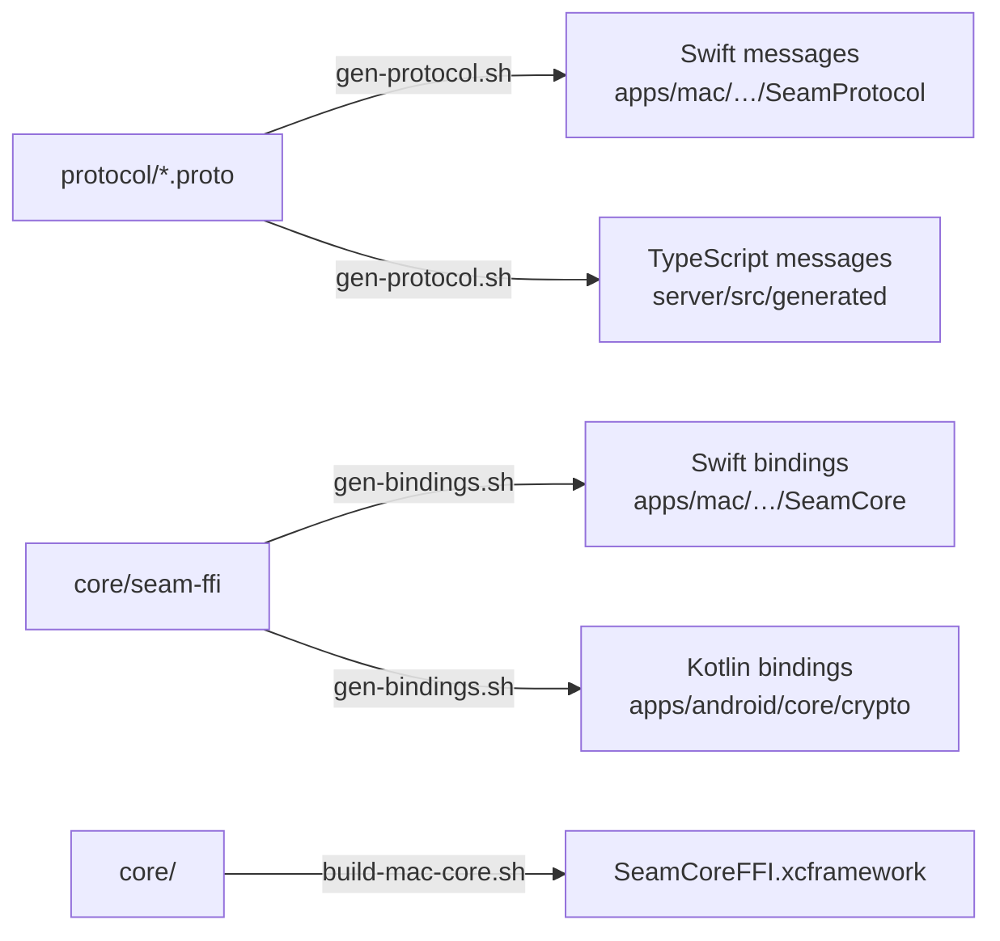

# Scripts

Helpers for code generation, builds and releases. Run them from anywhere; they find the repo root themselves.

| Script | What it does | When to run it |
|---|---|---|
| `gen-protocol.sh` | Checks the schema compiles, then generates Swift (`protoc-gen-swift`) and TypeScript (`protoc-gen-es`) from `protocol/`. Skips any generator that isn't installed, with a message. | After changing anything in `protocol/` |
| `gen-bindings.sh` | Builds `core/seam-ffi` and generates its Swift and Kotlin bindings with UniFFI | After changing `seam-ffi`'s public API |
| `build-mac-core.sh` | Builds the Rust core as `SeamCoreFFI.xcframework` for the Mac app. Host architecture by default; `ARCHS="arm64 x86_64"` for universal. | Before building or testing the Mac app, and after changing `core/` |
| `check-release.sh` | The release gate: the tag is on `main`, both apps carry its version, both build numbers went up since the last release, and the certificate pins are well formed | Run by the release workflow; locally with `MAIN_REF=HEAD scripts/check-release.sh vX.Y.Z` |
| `sign-mac-app.sh` | Signs `Seam.app` with Seam's certificate in a throwaway keychain, after checking it's the one pinned in `release/` | Run by the release workflow |
| `make-release-keys.sh` | One-time: protects releases on GitHub, makes the signing keys in an encrypted disk image, sets them as `release` environment secrets, and writes the fingerprints to `release/` | Once, by the maintainer (done for 0.1.0) |

Everything they generate is committed except the XCFramework, and CI fails if the committed code drifts from its source. Kotlin message types are generated by Gradle at build time, so they don't need a script.
