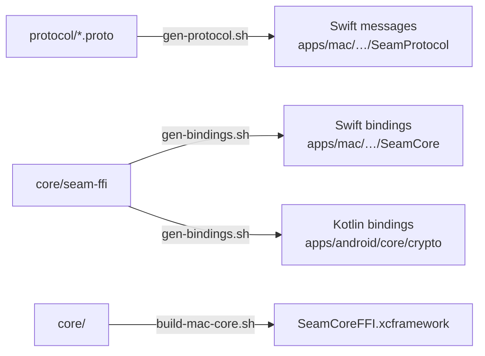

# Scripts

Helpers for code generation, builds and releases. Run them from anywhere; they find the repo root themselves.

| Script | What it does | When to run it |
|---|---|---|
| `gen-protocol.sh` | Checks the schema compiles, then generates Swift (`protoc-gen-swift`) from `protocol/`. Skips it, with a message, if the generator isn't installed. | After changing anything in `protocol/` |
| `gen-bindings.sh` | Builds `core/seam-ffi` and generates its Swift and Kotlin bindings with UniFFI | After changing `seam-ffi`'s public API |
| `build-mac-core.sh` | Builds the Rust core as `SeamCoreFFI.xcframework` for the Mac app. Host architecture, release, by default; `ARCHS="arm64 x86_64"` for universal; `PROFILE=debug` reuses `gen-bindings.sh`'s build (CI). | Before building or testing the Mac app, and after changing `core/` |
| `check-release.sh` | The release gate: the tag is on `main`, both apps carry its version, both build numbers went up since the last release, `CHANGELOG.md` has its section, the certificate pins are well formed, and the Mac update key is set | Run by the release workflow; locally with `MAIN_REF=HEAD scripts/check-release.sh vX.Y.Z` |
| `sign-mac-app.sh` | Signs `Seam.app` with Seam's certificate in a throwaway keychain, after checking it's the one pinned in `release/` | Run by the release workflow; `release-signing.yml` tests it with a throwaway certificate |
| `sign-android-apk.sh` | Aligns and signs an APK with Seam's key, and checks it has exactly one signer, the pinned one | Run by the release workflow; `release-signing.yml` tests it with a throwaway key |
| `release.sh` | A release in one command: bumps both apps' versions and build numbers and the README status lines, drafts the `CHANGELOG.md` section and opens it to edit, opens the release PR, waits for its checks, merges it and pushes the `vX.Y.Z` tag | `scripts/release.sh patch` (or `minor`, `major`, `X.Y.Z`) on an up-to-date `main` |
| `changes.sh` | Prints `CHANGELOG.md`'s section for a version; fails if there isn't one | Used by `release.sh`, `check-release.sh`, `make-appcast.sh` and the release workflow |
| `make-appcast.sh` | Writes Sparkle's `appcast.xml` for a release (with its `CHANGELOG.md` section as the release notes), signs the Mac update and the feed with the update key, and checks the key matches the app's `SUPublicEDKey` | Run by the release workflow |
| `make-update-key.sh` | One-time: makes the Mac update key in the release-keys disk image, stores it as a `release` secret, writes its public half to `apps/mac/Config/Release-Info.plist` | Once, by the maintainer, after `make-release-keys.sh` |
| `make-release-keys.sh` | One-time: protects releases on GitHub, makes the signing keys in an encrypted disk image, sets them as `release` environment secrets, and writes the fingerprints to `release/` | Once, by the maintainer (done for 0.1.0) |

Everything they generate is committed except the XCFramework, and CI fails if the committed code drifts from its source. Kotlin message types are generated by Gradle at build time, so they don't need a script.
