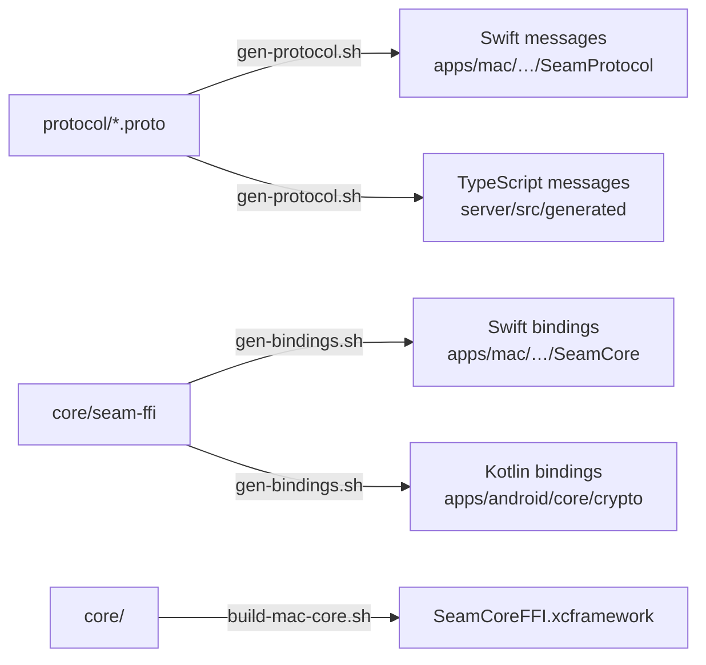

# Scripts

Helpers for code generation and builds. Run them from anywhere; they find the repo root themselves.

| Script | What it does | When to run it |
|---|---|---|
| `gen-protocol.sh` | Checks the schema compiles, then generates Swift (`protoc-gen-swift`) and TypeScript (`protoc-gen-es`) from `protocol/`. Skips any generator that isn't installed, with a message. | After changing anything in `protocol/` |
| `gen-bindings.sh` | Builds `core/seam-ffi` and generates its Swift and Kotlin bindings with UniFFI | After changing `seam-ffi`'s public API |
| `build-mac-core.sh` | Builds the Rust core as `SeamCoreFFI.xcframework` for the Mac app. Host architecture by default; `ARCHS="arm64 x86_64"` for universal. | Before building or testing the Mac app, and after changing `core/` |

Everything they generate is committed except the XCFramework, and CI fails if the committed code drifts from its source. Kotlin message types are generated by Gradle at build time, so they don't need a script.
