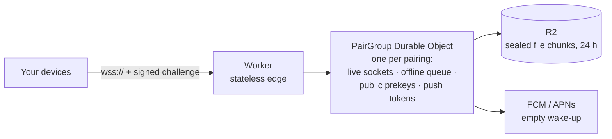

# Seam relay

The internet path between your devices: a Cloudflare Worker that routes sealed envelopes, queues them while a device sleeps, and wakes it with an empty push. It's a **blind postman**. It can't read anything it carries, and it's built so that it never needs to.

> **Status:** M1. Login, groups, pairing, the offline queue and prekey bundles work and are tested. Push notifications and R2 file storage arrive with the features that need them.

## What it does



| Job | Detail |
|---|---|
| **Log in** | The relay sends a fresh 32-byte challenge; the device signs `"seam-relay-login-v1" ‖ challenge ‖ group id` with its Ed25519 relay key. No passwords or tokens. |
| **Groups** | The first device to log in to a group id creates it (the Mac, at setup). Others join only with the one-time token from the pairing QR code; members are told with `PeerJoined`. |
| **Pair** | A member opens a single-use slot holding only the token's SHA-256, valid for at most 5 minutes |
| **Route** | Sealed envelopes go between members' relay keys. The sender must be the logged-in key and the recipient another member. Rotating mailbox ids come later. |
| **Queue** | Every envelope is queued until the recipient sends `Delivered` (at least once). Up to 1,000 envelopes or 10 MB per device, 1.1 MB each, for at most 24 hours; delivered oldest first on login |
| **Prekeys** | Stores each device's opaque prekey bundles and hands out one per request, keeping the last as a last resort |
| **Wake** (later) | Will send an FCM or APNs push that says only "check in" |

### What it must never do

- Decrypt anything, or hold any private key
- Log IP addresses, envelope contents or who sent what to whom
- Keep messages after they're acked or expired
- Depend on Cloudflare-only features the protocol can't live without. The relay has to stay **self-hostable**, for people who run their own.

## Layout

| File | What |
|---|---|
| `src/index.ts` | Worker entry: `/health`, and `/v1/connect?group=<base64url>` → the group's Durable Object |
| `src/pair-group.ts` | The `PairGroup` Durable Object: hibernating WebSockets and storage, adapted onto `group.ts` |
| `src/group.ts` | All the protocol logic, free of Cloudflare APIs so it's tested in plain Node |

## Running locally

```bash
cd server
npm ci
npm run dev          # wrangler dev on http://localhost:8787
curl localhost:8787/health
```

## Testing

```bash
npm test             # vitest
npm run typecheck    # Worker code and tests, separately
```

| Suite | What it proves |
|---|---|
| `relay.test.ts` | Login (fresh challenge per connection, bad signature, wrong group, replayed challenge, strangers), pairing (valid, wrong, expired, reused and over-long slots), relaying (online, queued then delivered in order, ack deletes, redelivery, spoofed sender, non-members, size, count and byte limits, expiry), prekey bundles, routes |
| `protocol.test.ts` | The relay decodes the shared golden vector exactly as the Mac and Android apps do |

## Generated code

`src/generated/` comes from `protocol/` via `scripts/gen-protocol.sh` (protoc-gen-es, installed by `npm ci`). Don't edit it by hand.

## Licence note

The relay is AGPL-3.0. If you run a **modified** relay as a public service, the AGPL requires you to offer its source code to the people who use it.
