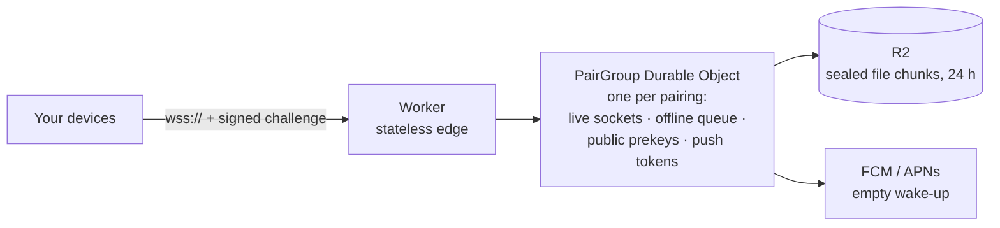

# Seam relay

The internet path between your devices: a Cloudflare Worker that routes sealed envelopes, queues them while a device sleeps, and wakes it with an empty push. It's a **blind postman**. It can't read anything it carries, and it's built so that it never needs to.

> **Status:** M1. Login, groups, pairing, the offline queue and prekey bundles work and are tested. Push notifications and R2 file storage arrive with the features that need them.

## What it does



| Job | Detail |
|---|---|
| **Log in** | The relay sends a fresh 32-byte challenge; the device signs `"seam-relay-login-v1" ‖ challenge ‖ group id` with its Ed25519 relay key. No passwords or tokens. |
| **Groups** | A group is created only by a login that asks for it (`create_group`, the Mac at setup). Others join only with the one-time token from the pairing QR code; members are told with `PeerJoined`. At most 8 members; any member can remove itself or another (`RemoveMember`, used for unpairing), which deletes that member's queue and bundles and closes its sockets. |
| **Pair** | A member opens a single-use slot holding only the token's SHA-256, valid for at most 5 minutes. While it's open, no other member can replace it; its opener can replace or close it (`ClosePairing`). |
| **Route** | Sealed envelopes go between members' relay keys. The sender must be the logged-in key and the recipient another member. Rotating mailbox ids come later. |
| **Queue** | Every envelope is queued until the recipient sends `Delivered` (at least once). Up to 1,000 envelopes or 10 MB per device (expired ones don't count), 1.1 MB each, for at most 24 hours; delivered oldest first on login |
| **Prekeys** | Stores each device's opaque prekey bundles (at most 100, 4 KB each) and hands out one per request, keeping the last as a last resort; each member may request 20 per 10 minutes |
| **Housekeeping** | A Durable Object alarm closes sockets that haven't logged in within 10 seconds, deletes expired envelopes and pairing slots, and deletes a group nobody has logged in to for 90 days |
| **Limits** | Frames over 1.2 MB are refused unread; a bad frame before login closes the socket; at most 16 sockets per group may be waiting to log in; connects are rate-limited per client at the edge (the IP is the limiter's key only, never logged or stored); request logging is pinned off |
| **Wake** (later) | Will send an FCM or APNs push that says only "check in" |

### What it must never do

- Decrypt anything, or hold any private key
- Log IP addresses, envelope contents or who sent what to whom
- Keep messages after they're acked or expired
- Depend on Cloudflare-only features the protocol can't live without. The relay has to stay **self-hostable**, for people who run their own.

## Layout

| File | What |
|---|---|
| `src/index.ts` | Worker entry: `/health`, and `/v1/connect?group=<base64url>` → the group's Durable Object |
| `src/pair-group.ts` | The `PairGroup` Durable Object: hibernating WebSockets and storage, adapted onto `group.ts` |
| `src/group.ts` | All the protocol logic, free of Cloudflare APIs so it's tested in plain Node |

## Running locally

```bash
cd server
npm ci
npm run dev          # wrangler dev on http://localhost:8787
curl localhost:8787/health
```

## Deploying

The relay runs on Cloudflare Workers with SQLite-backed Durable Objects. Check that your plan includes them and the rate-limiting binding: the free plan is expected to (verify on Cloudflare's pricing page).

**First deploy, from your machine:**

```bash
cd server
npm ci
npx wrangler login   # opens the browser once
npx wrangler deploy  # prints the address, e.g. https://seam-relay.<account>.workers.dev
curl https://seam-relay.<account>.workers.dev/health
```

**Later deploys, from GitHub** (the `deploy-relay` workflow, run from the Actions tab or by pushing a `relay-v*` tag). One-time setup:

1. In Cloudflare, create an API token with the **Edit Cloudflare Workers** template, limited to your account.
2. In GitHub → Settings → Environments, create `production`. Add yourself as a required reviewer if every deploy should wait for your OK.
3. Add two environment secrets there: `CLOUDFLARE_API_TOKEN` and `CLOUDFLARE_ACCOUNT_ID` (on the Workers overview page).

The workflow runs the typecheck and tests before it deploys, and never runs on a pull request.

**Custom domain (optional):** add it under `routes` in `wrangler.toml` (the comment shows how) and deploy again.

**Then point the apps at it:** set `RelayPolicy.productionURL` in `apps/mac/Packages/SeamSession/Sources/SeamSession/RelayPolicy.swift` to the `wss://` address. The phone needs no change: it takes the relay from the Mac's pairing code.

## Testing

```bash
npm test             # vitest
npm run typecheck    # Worker code and tests, separately
```

| Suite | What it proves |
|---|---|
| `relay.test.ts` | Login (fresh challenge, bad signature, wrong group, replayed challenge, strangers, explicit group creation, 10-second deadline, pre-login cap, oversized and malformed frames), pairing (valid, wrong, expired, reused and over-long slots, member cap, slot ownership, `RemoveMember`), relaying (online, queued then delivered in order, ack deletes, redelivery, spoofed sender, non-members, bad envelopes, size, count and byte limits, expiry, expired entries not counted, counters without listing), housekeeping alarm, bundle caps and rate limit, storage errors, routes (rate limit, clean forwarded request, case-insensitive upgrade) |
| `protocol.test.ts` | The relay decodes the shared golden vector exactly as the Mac and Android apps do |

## Generated code

`src/generated/` comes from `protocol/` via `scripts/gen-protocol.sh` (protoc-gen-es, installed by `npm ci`). Don't edit it by hand.

## Licence note

The relay is AGPL-3.0. If you run a **modified** relay as a public service, the AGPL requires you to offer its source code to the people who use it.
