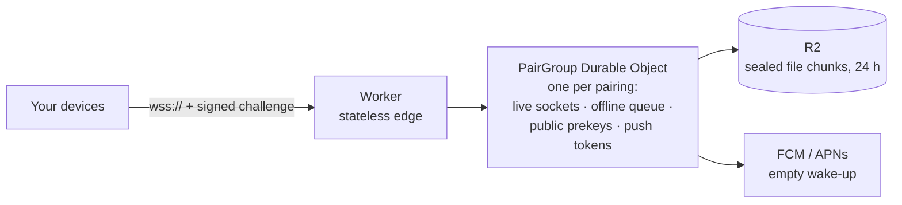

# Seam relay

The internet path between your devices: a Cloudflare Worker that routes sealed envelopes, queues them while a device sleeps, and wakes it with an empty push. It's a **blind postman**. It can't read anything it carries, and it's built so that it never needs to.

> **Status:** M0 skeleton. A health check, the generated message types and tests. The relay itself arrives in M1.

## What it will do



| Job | Detail |
|---|---|
| **Log in** | The device signs a random challenge with its identity key. No passwords or tokens. |
| **Route** | Sealed envelopes go between a pairing's rotating mailbox ids, never device ids |
| **Queue** | Up to 1,000 envelopes or 10 MB per device, for at most 24 hours; deleted on ack |
| **Prekeys** | Stores public prekey bundles so a device can start a session while the other is offline |
| **Wake** | Sends an FCM or APNs push that says only "check in" |

### What it must never do

- Decrypt anything, or hold any private key
- Log IP addresses, envelope contents or who sent what to whom
- Keep messages after they're acked or expired
- Depend on Cloudflare-only features the protocol can't live without. The relay has to stay **self-hostable**, for people who run their own.

## Running locally

```bash
cd server
npm ci
npm run dev          # wrangler dev on http://localhost:8787
curl localhost:8787/health
```

## Testing

```bash
npm test             # vitest
npm run typecheck    # Worker code and tests, separately
```

| Test | What it proves |
|---|---|
| Golden vector | The relay decodes the shared vector exactly as the Mac and Android apps do |
| Health check | Answers `/health` and 404s everything else |

## Generated code

`src/generated/` comes from `protocol/` via `scripts/gen-protocol.sh` (protoc-gen-es, installed by `npm ci`). Don't edit it by hand.

## Licence note

The relay is AGPL-3.0. If you run a **modified** relay as a public service, the AGPL requires you to offer its source code to the people who use it.
